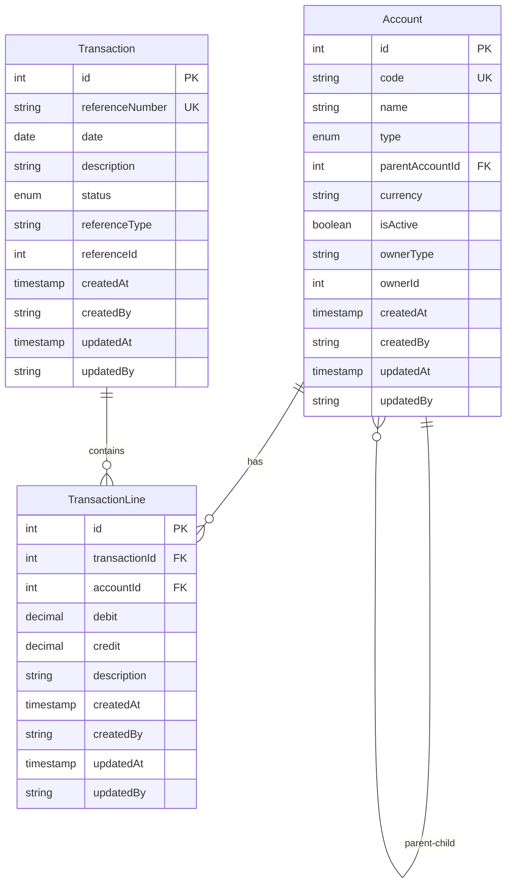

# Design Document: Accounting Module

## Overview

The accounting module implements a double-entry bookkeeping system for the existing NestJS backend project. It provides a chart of accounts with hierarchical structure, financial transactions with multiple lines, and comprehensive validation to ensure accounting integrity. The module follows established project patterns for entities, DTOs, services, controllers, and mappers as seen in the journey, supplier, expense, and client modules.

### Key Features

- Chart of accounts with hierarchical structure and account types (ASSET, LIABILITY, EQUITY, REVENUE, EXPENSE)
- Financial transactions with status management (DRAFT, POSTED, CANCELLED)
- Transaction lines implementing double-entry bookkeeping (debits and credits)
- Automatic code generation for accounts and transaction reference numbers
- Atomic transaction creation with all lines in a single database transaction
- Account reference validation ensuring only active accounts are used
- Transaction reference linking to other business entities (Journey, Expense, etc.)
- REST APIs with authentication, authorization, and pagination
- Comprehensive query and filtering capabilities

### Design Principles

- Follow existing NestJS module patterns (TypeORM entities, DTOs, services, controllers, mappers)
- Extend BaseEntity for audit trail (createdBy, createdAt, updatedBy, updatedAt, deletedBy, deletedAt)
- Use TypeORM decorators for entity relationships and constraints
- Implement validation using class-validator decorators
- Use Swagger/OpenAPI decorators for API documentation
- Ensure atomic operations using database transactions
- Enforce double-entry bookkeeping rules at the service layer

## Architecture

### Module Structure

```
src/app/modules/accounting/
├── dtos/
│   ├── account.dto.ts
│   ├── create-account.dto.ts
│   ├── update-account.dto.ts
│   ├── query-account.dto.ts
│   ├── transaction.dto.ts
│   ├── create-transaction.dto.ts
│   ├── update-transaction.dto.ts
│   ├── query-transaction.dto.ts
│   ├── transaction-line.dto.ts
│   ├── create-transaction-line.dto.ts
│   └── update-transaction-line.dto.ts
├── account.entity.ts
├── transaction.entity.ts
├── transaction-line.entity.ts
├── account.service.ts
├── transaction.service.ts
├── transaction-line.service.ts
├── account.controller.ts
├── transaction.controller.ts
├── account.mapper.ts
├── transaction.mapper.ts
├── transaction-line.mapper.ts
└── accounting.module.ts
```

### Layer Responsibilities

#### Entity Layer
- Define database schema using TypeORM decorators
- Extend BaseEntity for audit fields
- Define relationships between entities (Account ↔ TransactionLine, Transaction ↔ TransactionLine)
- Define enums for AccountType and TransactionStatus

#### DTO Layer
- Define data transfer objects for API requests and responses
- Use class-validator decorators for input validation
- Use Swagger decorators for API documentation
- Separate DTOs for create, update, query, and response operations

#### Service Layer
- Implement business logic and validation rules
- Provide CRUD operations (findById, findByFields, find, findAndCount, save, update, delete)
- Enforce double-entry bookkeeping rules
- Generate unique codes for accounts and transactions
- Handle database transactions for atomic operations

#### Controller Layer
- Define REST API endpoints
- Use AuthGuard and RolesGuard for authentication and authorization
- Implement pagination using PageRequest and HeaderUtil
- Validate foreign key references
- Transform between DTOs and entities using mappers

#### Mapper Layer
- Transform entities to DTOs (selective mapping)
- Transform create/update DTOs to entities
- Support both single entity and array transformations

### Integration Points

- **BaseEntity**: All entities extend this for audit fields
- **GeneratorTypes enum**: Add ACCOUNT type for code generation
- **withTransaction utility**: Use for atomic operations
- **PageRequest**: Use for pagination in controllers
- **HeaderUtil**: Use for adding pagination headers to responses
- **AuthGuard/RolesGuard**: Use for authentication and authorization
- **Journey/Expense modules**: Link transactions via referenceType and referenceId

## Components and Interfaces

### Entities

#### Account Entity

```typescript
import { Column, Entity, ManyToOne, JoinColumn, OneToMany } from 'typeorm';
import { BaseEntity } from 'src/core/utils/base.entity';

export enum AccountType {
  ASSET = 'ASSET',
  LIABILITY = 'LIABILITY',
  EQUITY = 'EQUITY',
  REVENUE = 'REVENUE',
  EXPENSE = 'EXPENSE',
}

@Entity('accounts')
export class Account extends BaseEntity {
  @Column({ type: 'varchar', length: 50, unique: true })
  code: string;

  @Column({ type: 'varchar', length: 255 })
  name: string;

  @Column({
    type: 'enum',
    enum: AccountType,
  })
  type: AccountType;

  @Column({ type: 'int', nullable: true })
  parentAccountId?: number;

  @ManyToOne(() => Account, { nullable: true })
  @JoinColumn({ name: 'parent_account_id' })
  parentAccount?: Account;

  @OneToMany(() => Account, (account) => account.parentAccount)
  childAccounts?: Account[];

  @Column({ type: 'varchar', length: 10, default: 'USD' })
  currency: string;

  @Column({ type: 'boolean', default: true })
  isActive: boolean;

  @Column({ type: 'varchar', length: 50, nullable: true })
  ownerType?: string;

  @Column({ type: 'int', nullable: true })
  ownerId?: number;

  @OneToMany(() => TransactionLine, (line) => line.account)
  transactionLines?: TransactionLine[];
}
```

#### Transaction Entity

```typescript
import { Column, Entity, OneToMany } from 'typeorm';
import { BaseEntity } from 'src/core/utils/base.entity';

export enum TransactionStatus {
  DRAFT = 'DRAFT',
  POSTED = 'POSTED',
  CANCELLED = 'CANCELLED',
}

@Entity('transactions')
export class Transaction extends BaseEntity {
  @Column({ type: 'varchar', length: 50, unique: true })
  referenceNumber: string;

  @Column({ type: 'date' })
  date: Date;

  @Column({ type: 'text' })
  description: string;

  @Column({
    type: 'enum',
    enum: TransactionStatus,
    default: TransactionStatus.DRAFT,
  })
  status: TransactionStatus;

  @Column({ type: 'varchar', length: 50, nullable: true })
  referenceType?: string;

  @Column({ type: 'int', nullable: true })
  referenceId?: number;

  @OneToMany(() => TransactionLine, (line) => line.transaction, { cascade: true })
  lines?: TransactionLine[];
}
```

#### TransactionLine Entity

```typescript
import { Column, Entity, ManyToOne, JoinColumn } from 'typeorm';
import { BaseEntity } from 'src/core/utils/base.entity';
import { Transaction } from './transaction.entity';
import { Account } from './account.entity';

@Entity('transaction_lines')
export class TransactionLine extends BaseEntity {
  @Column({ type: 'int' })
  transactionId: number;

  @ManyToOne(() => Transaction, (transaction) => transaction.lines, { nullable: false })
  @JoinColumn({ name: 'transaction_id' })
  transaction: Transaction;

  @Column({ type: 'int' })
  accountId: number;

  @ManyToOne(() => Account, (account) => account.transactionLines, { nullable: false, eager: true })
  @JoinColumn({ name: 'account_id' })
  account: Account;

  @Column({ type: 'decimal', precision: 12, scale: 2, default: 0 })
  debit: string;

  @Column({ type: 'decimal', precision: 12, scale: 2, default: 0 })
  credit: string;

  @Column({ type: 'text', nullable: true })
  description?: string;
}
```

### DTOs

#### Account DTOs

```typescript
// account.dto.ts
import { ApiProperty, ApiPropertyOptional } from '@nestjs/swagger';
import { BaseDTO } from 'src/core/utils/base.dto';
import { IsString, IsEnum, IsBoolean, IsOptional, IsInt } from 'class-validator';
import { AccountType } from '../account.entity';

export class AccountDTO extends BaseDTO {
  @ApiProperty({ description: 'Unique account code', example: 'A-123456' })
  @IsString()
  code: string;

  @ApiProperty({ description: 'Account name', example: 'Cash in Bank' })
  @IsString()
  name: string;

  @ApiProperty({ description: 'Account type', enum: AccountType, example: AccountType.ASSET })
  @IsEnum(AccountType)
  type: AccountType;

  @ApiPropertyOptional({ description: 'Parent account ID for hierarchical structure' })
  @IsOptional()
  @IsInt()
  parentAccountId?: number;

  @ApiProperty({ description: 'Currency code', example: 'USD', default: 'USD' })
  @IsString()
  currency: string;

  @ApiProperty({ description: 'Whether the account is active', default: true })
  @IsBoolean()
  isActive: boolean;

  @ApiPropertyOptional({ description: 'Owner type (e.g., CUSTOMER, SUPPLIER)' })
  @IsOptional()
  @IsString()
  ownerType?: string;

  @ApiPropertyOptional({ description: 'Owner entity ID' })
  @IsOptional()
  @IsInt()
  ownerId?: number;
}
```

```typescript
// create-account.dto.ts
import { OmitType } from '@nestjs/swagger';
import { AccountDTO } from './account.dto';

export class CreateAccountDTO extends OmitType(AccountDTO, [
  'id',
  'code',
  'createdAt',
  'updatedAt',
  'deletedAt',
  'createdBy',
  'updatedBy',
  'deletedBy',
] as const) {}

// update-account.dto.ts
import { PartialType } from '@nestjs/swagger';
import { CreateAccountDTO } from './create-account.dto';

export class UpdateAccountDTO extends PartialType(CreateAccountDTO) {}

// query-account.dto.ts
import { ApiPropertyOptional } from '@nestjs/swagger';
import { IsOptional, IsEnum, IsBoolean } from 'class-validator';
import { PaginateDTO } from 'src/core/utils/pagination.entity';
import { AccountType } from '../account.entity';

export class QueryAccountDTO extends PaginateDTO {
  @ApiPropertyOptional({ description: 'Filter by account type', enum: AccountType })
  @IsOptional()
  @IsEnum(AccountType)
  type?: AccountType;

  @ApiPropertyOptional({ description: 'Filter by active status' })
  @IsOptional()
  @IsBoolean()
  isActive?: boolean;
}
```

#### Transaction DTOs

```typescript
// transaction.dto.ts
import { ApiProperty, ApiPropertyOptional } from '@nestjs/swagger';
import { BaseDTO } from 'src/core/utils/base.dto';
import { IsString, IsEnum, IsDateString, IsOptional, IsInt, IsArray, ValidateNested } from 'class-validator';
import { Type } from 'class-transformer';
import { TransactionStatus } from '../transaction.entity';
import { TransactionLineDTO } from './transaction-line.dto';

export class TransactionDTO extends BaseDTO {
  @ApiProperty({ description: 'Unique transaction reference number', example: 'TXN-2024-00001' })
  @IsString()
  referenceNumber: string;

  @ApiProperty({ description: 'Transaction date', example: '2024-01-15' })
  @IsDateString()
  date: Date;

  @ApiProperty({ description: 'Transaction description', example: 'Payment for supplies' })
  @IsString()
  description: string;

  @ApiProperty({ description: 'Transaction status', enum: TransactionStatus, default: TransactionStatus.DRAFT })
  @IsEnum(TransactionStatus)
  status: TransactionStatus;

  @ApiPropertyOptional({ description: 'Reference type (e.g., JOURNEY, EXPENSE)' })
  @IsOptional()
  @IsString()
  referenceType?: string;

  @ApiPropertyOptional({ description: 'Reference entity ID' })
  @IsOptional()
  @IsInt()
  referenceId?: number;

  @ApiProperty({ description: 'Transaction lines', type: [TransactionLineDTO] })
  @IsArray()
  @ValidateNested({ each: true })
  @Type(() => TransactionLineDTO)
  lines?: TransactionLineDTO[];
}

// create-transaction.dto.ts
import { OmitType } from '@nestjs/swagger';
import { TransactionDTO } from './transaction.dto';
import { ApiProperty } from '@nestjs/swagger';
import { IsArray, ValidateNested } from 'class-validator';
import { Type } from 'class-transformer';
import { CreateTransactionLineDTO } from './create-transaction-line.dto';

export class CreateTransactionDTO extends OmitType(TransactionDTO, [
  'id',
  'referenceNumber',
  'createdAt',
  'updatedAt',
  'deletedAt',
  'createdBy',
  'updatedBy',
  'deletedBy',
  'lines',
] as const) {
  @ApiProperty({ description: 'Transaction lines', type: [CreateTransactionLineDTO] })
  @IsArray()
  @ValidateNested({ each: true })
  @Type(() => CreateTransactionLineDTO)
  lines: CreateTransactionLineDTO[];
}
```

```typescript
// update-transaction.dto.ts
import { PartialType, OmitType } from '@nestjs/swagger';
import { TransactionDTO } from './transaction.dto';

export class UpdateTransactionDTO extends PartialType(
  OmitType(TransactionDTO, [
    'id',
    'referenceNumber',
    'createdAt',
    'updatedAt',
    'deletedAt',
    'createdBy',
    'updatedBy',
    'deletedBy',
    'lines',
  ] as const)
) {}

// query-transaction.dto.ts
import { ApiPropertyOptional } from '@nestjs/swagger';
import { IsOptional, IsEnum, IsDateString, IsString, IsInt } from 'class-validator';
import { PaginateDTO } from 'src/core/utils/pagination.entity';
import { TransactionStatus } from '../transaction.entity';

export class QueryTransactionDTO extends PaginateDTO {
  @ApiPropertyOptional({ description: 'Filter by transaction status', enum: TransactionStatus })
  @IsOptional()
  @IsEnum(TransactionStatus)
  status?: TransactionStatus;

  @ApiPropertyOptional({ description: 'Filter by date from', example: '2024-01-01' })
  @IsOptional()
  @IsDateString()
  dateFrom?: string;

  @ApiPropertyOptional({ description: 'Filter by date to', example: '2024-12-31' })
  @IsOptional()
  @IsDateString()
  dateTo?: string;

  @ApiPropertyOptional({ description: 'Filter by reference type' })
  @IsOptional()
  @IsString()
  referenceType?: string;

  @ApiPropertyOptional({ description: 'Filter by reference ID' })
  @IsOptional()
  @IsInt()
  referenceId?: number;
}
```

#### TransactionLine DTOs

```typescript
// transaction-line.dto.ts
import { ApiProperty, ApiPropertyOptional } from '@nestjs/swagger';
import { BaseDTO } from 'src/core/utils/base.dto';
import { IsString, IsInt, IsOptional, IsNumberString } from 'class-validator';
import { AccountDTO } from './account.dto';

export class TransactionLineDTO extends BaseDTO {
  @ApiProperty({ description: 'Transaction ID' })
  @IsInt()
  transactionId: number;

  @ApiProperty({ description: 'Account ID' })
  @IsInt()
  accountId: number;

  @ApiPropertyOptional({ description: 'Account details', type: () => AccountDTO })
  account?: AccountDTO;

  @ApiProperty({ description: 'Debit amount', example: '1000.00' })
  @IsNumberString()
  debit: string;

  @ApiProperty({ description: 'Credit amount', example: '0.00' })
  @IsNumberString()
  credit: string;

  @ApiPropertyOptional({ description: 'Line description' })
  @IsOptional()
  @IsString()
  description?: string;
}

// create-transaction-line.dto.ts
import { OmitType } from '@nestjs/swagger';
import { TransactionLineDTO } from './transaction-line.dto';

export class CreateTransactionLineDTO extends OmitType(TransactionLineDTO, [
  'id',
  'transactionId',
  'account',
  'createdAt',
  'updatedAt',
  'deletedAt',
  'createdBy',
  'updatedBy',
  'deletedBy',
] as const) {}

// update-transaction-line.dto.ts
import { PartialType } from '@nestjs/swagger';
import { CreateTransactionLineDTO } from './create-transaction-line.dto';

export class UpdateTransactionLineDTO extends PartialType(CreateTransactionLineDTO) {}
```

### Services

#### Account Service

```typescript
import { Injectable } from '@nestjs/common';
import { InjectRepository } from '@nestjs/typeorm';
import { Repository, FindManyOptions, FindOneOptions } from 'typeorm';
import { Account } from './account.entity';
import { generateUniqueCode } from 'src/core/utils/generator';
import { GeneratorTypes } from 'src/core/enums/generator-types';
import { QueryAccountDTO } from './dtos/query-account.dto';

@Injectable()
export class AccountService {
  constructor(
    @InjectRepository(Account)
    private readonly accountRepository: Repository<Account>,
  ) {}

  async findById(id: number): Promise<Account | undefined> {
    const result = await this.accountRepository.findOne({ where: { id } });
    return result || undefined;
  }

  async findByFields(options: FindOneOptions<Account>): Promise<Account | undefined> {
    const result = await this.accountRepository.findOne(options);
    return result || undefined;
  }

  async find(options: FindManyOptions<Account>): Promise<Account[]> {
    return await this.accountRepository.find(options);
  }

  async findAndCount(query: QueryAccountDTO): Promise<[Account[], number]> {
    const options: FindManyOptions<Account> = {
      skip: (query.page - 1) * query.pageSize,
      take: query.pageSize,
      order: query.sortField ? { [query.sortField]: query.sortOrder || 'ASC' } : { createdAt: 'DESC' },
      where: {},
    };

    if (query.type) {
      options.where = { ...options.where, type: query.type };
    }

    if (query.isActive !== undefined) {
      options.where = { ...options.where, isActive: query.isActive };
    }

    return this.accountRepository.findAndCount(options);
  }

  async save(account: Account, creator?: string): Promise<Account> {
    const now = new Date();

    // Generate unique code if not provided
    if (!account.code) {
      account.code = await generateUniqueCode(
        this.accountRepository,
        GeneratorTypes.ACCOUNT,
        'code',
      );
    }

    account.createdAt = account.createdAt ?? now;
    account.updatedAt = now;

    if (creator) {
      account.createdBy = account.createdBy ?? creator;
      account.updatedBy = creator;
    }

    return await this.accountRepository.save(account);
  }

  async update(account: Account, updater?: string): Promise<Account> {
    const now = new Date();
    account.updatedAt = now;
    if (updater) account.updatedBy = updater;
    return await this.accountRepository.save(account);
  }

  async delete(id: number): Promise<void> {
    await this.accountRepository.delete(id);
  }
}
```

#### Transaction Service

```typescript
import { Injectable, BadRequestException } from '@nestjs/common';
import { InjectRepository } from '@nestjs/typeorm';
import { Repository, FindManyOptions, FindOneOptions, Between } from 'typeorm';
import { Transaction, TransactionStatus } from './transaction.entity';
import { QueryTransactionDTO } from './dtos/query-transaction.dto';

@Injectable()
export class TransactionService {
  constructor(
    @InjectRepository(Transaction)
    private readonly transactionRepository: Repository<Transaction>,
  ) {}

  async findById(id: number): Promise<Transaction | undefined> {
    const result = await this.transactionRepository.findOne({
      where: { id },
      relations: ['lines', 'lines.account']
    });
    return result || undefined;
  }

  async findByFields(options: FindOneOptions<Transaction>): Promise<Transaction | undefined> {
    const result = await this.transactionRepository.findOne(options);
    return result || undefined;
  }

  async find(options: FindManyOptions<Transaction>): Promise<Transaction[]> {
    return await this.transactionRepository.find(options);
  }

  async findAndCount(query: QueryTransactionDTO): Promise<[Transaction[], number]> {
    const options: FindManyOptions<Transaction> = {
      skip: (query.page - 1) * query.pageSize,
      take: query.pageSize,
      order: query.sortField ? { [query.sortField]: query.sortOrder || 'ASC' } : { createdAt: 'DESC' },
      where: {},
      relations: ['lines', 'lines.account'],
    };

    if (query.status) {
      options.where = { ...options.where, status: query.status };
    }

    if (query.dateFrom && query.dateTo) {
      options.where = { ...options.where, date: Between(query.dateFrom, query.dateTo) };
    } else if (query.dateFrom) {
      options.where = { ...options.where, date: Between(query.dateFrom, '9999-12-31') };
    } else if (query.dateTo) {
      options.where = { ...options.where, date: Between('1900-01-01', query.dateTo) };
    }

    if (query.referenceType) {
      options.where = { ...options.where, referenceType: query.referenceType };
    }

    if (query.referenceId) {
      options.where = { ...options.where, referenceId: query.referenceId };
    }

    return this.transactionRepository.findAndCount(options);
  }

  async save(transaction: Transaction, creator?: string): Promise<Transaction> {
    const now = new Date();

    // Generate unique reference number
    transaction.referenceNumber = await this.generateUniqueReferenceNumber();

    transaction.createdAt = transaction.createdAt ?? now;
    transaction.updatedAt = now;

    if (creator) {
      transaction.createdBy = transaction.createdBy ?? creator;
      transaction.updatedBy = creator;
    }

    // Validate transaction before saving
    this.validateTransaction(transaction);

    return await this.transactionRepository.save(transaction);
  }

  async update(transaction: Transaction, updater?: string): Promise<Transaction> {
    const now = new Date();
    transaction.updatedAt = now;
    if (updater) transaction.updatedBy = updater;

    // Prevent modification of posted or cancelled transactions
    if (transaction.status === TransactionStatus.POSTED || transaction.status === TransactionStatus.CANCELLED) {
      throw new BadRequestException(`Cannot modify transaction with status ${transaction.status}`);
    }

    // Validate transaction before updating
    this.validateTransaction(transaction);

    return await this.transactionRepository.save(transaction);
  }

  async delete(id: number): Promise<void> {
    await this.transactionRepository.delete(id);
  }

  private validateTransaction(transaction: Transaction): void {
    if (!transaction.lines || transaction.lines.length < 2) {
      throw new BadRequestException('Transaction must contain at least two transaction lines');
    }

    // Validate each line
    for (const line of transaction.lines) {
      const debit = parseFloat(line.debit);
      const credit = parseFloat(line.credit);

      // Both cannot be non-zero
      if (debit > 0 && credit > 0) {
        throw new BadRequestException('Transaction line cannot have both debit and credit values');
      }

      // At least one must be non-zero
      if (debit === 0 && credit === 0) {
        throw new BadRequestException('Transaction line must have either debit or credit value');
      }
    }

    // Validate balance when posting
    if (transaction.status === TransactionStatus.POSTED) {
      const totalDebits = transaction.lines.reduce((sum, line) => sum + parseFloat(line.debit), 0);
      const totalCredits = transaction.lines.reduce((sum, line) => sum + parseFloat(line.credit), 0);

      if (Math.abs(totalDebits - totalCredits) > 0.01) {
        throw new BadRequestException('Transaction is not balanced: debits must equal credits');
      }
    }
  }

  private async generateUniqueReferenceNumber(): Promise<string> {
    let unique = false;
    let referenceNumber: string;

    do {
      const date = new Date();
      const year = date.getFullYear();
      const sequential = Math.floor(10000 + Math.random() * 90000);
      referenceNumber = `TXN-${year}-${String(sequential).padStart(5, '0')}`;

      const existing = await this.transactionRepository.findOne({
        where: { referenceNumber },
      });
      unique = !existing;
    } while (!unique);

    return referenceNumber;
  }
}
```

#### TransactionLine Service

```typescript
import { Injectable } from '@nestjs/common';
import { InjectRepository } from '@nestjs/typeorm';
import { Repository, FindManyOptions, FindOneOptions } from 'typeorm';
import { TransactionLine } from './transaction-line.entity';

@Injectable()
export class TransactionLineService {
  constructor(
    @InjectRepository(TransactionLine)
    private readonly transactionLineRepository: Repository<TransactionLine>,
  ) {}

  async findById(id: number): Promise<TransactionLine | undefined> {
    const result = await this.transactionLineRepository.findOne({
      where: { id },
      relations: ['account', 'transaction']
    });
    return result || undefined;
  }

  async findByFields(options: FindOneOptions<TransactionLine>): Promise<TransactionLine | undefined> {
    const result = await this.transactionLineRepository.findOne(options);
    return result || undefined;
  }

  async find(options: FindManyOptions<TransactionLine>): Promise<TransactionLine[]> {
    return await this.transactionLineRepository.find(options);
  }

  async findAndCount(options: FindManyOptions<TransactionLine>): Promise<[TransactionLine[], number]> {
    return this.transactionLineRepository.findAndCount(options);
  }

  async save(line: TransactionLine, creator?: string): Promise<TransactionLine> {
    const now = new Date();
    line.createdAt = line.createdAt ?? now;
    line.updatedAt = now;

    if (creator) {
      line.createdBy = line.createdBy ?? creator;
      line.updatedBy = creator;
    }

    return await this.transactionLineRepository.save(line);
  }

  async update(line: TransactionLine, updater?: string): Promise<TransactionLine> {
    const now = new Date();
    line.updatedAt = now;
    if (updater) line.updatedBy = updater;
    return await this.transactionLineRepository.save(line);
  }

  async delete(id: number): Promise<void> {
    await this.transactionLineRepository.delete(id);
  }
}
```

### Controllers

#### Account Controller

```typescript
import {
  Body,
  Controller,
  Delete,
  Get,
  Logger,
  NotFoundException,
  Param,
  ParseIntPipe,
  Post,
  Put,
  Query,
  Req,
  UseGuards,
} from '@nestjs/common';
import { ApiBearerAuth, ApiOperation, ApiResponse, ApiTags } from '@nestjs/swagger';
import { AuthGuard, AuthUser, Roles, RolesGuard } from 'src/core/security';
import { UserRole } from 'src/core/enums/user-role';
import type { Request } from 'src/core/utils/request';
import { PageRequest } from 'src/core/utils/pagination.entity';
import { HeaderUtil } from 'src/core/utils/header-util';

import { AccountService } from './account.service';
import { AccountDTO } from './dtos/account.dto';
import { CreateAccountDTO } from './dtos/create-account.dto';
import { UpdateAccountDTO } from './dtos/update-account.dto';
import { QueryAccountDTO } from './dtos/query-account.dto';
import {
  mapAccountToAccountDtoSelective,
  mapCreateAccountDtoToEntity,
  mapUpdateAccountDtoToEntity,
} from './account.mapper';

@Controller('api/accounting/accounts')
@ApiBearerAuth()
@UseGuards(AuthGuard, RolesGuard)
@Roles(UserRole.ADMIN)
@ApiTags('accounting-accounts')
export class AccountController {
  logger = new Logger('AccountController');

  constructor(private readonly accountService: AccountService) {}

  @Get('/')
  @Roles(UserRole.ADMIN, UserRole.USER)
  @ApiOperation({ summary: 'Get list of accounts paginated' })
  @ApiResponse({ status: 200, description: 'List of accounts', type: AccountDTO, isArray: true })
  async getAll(@Req() req: Request, @Query() query: QueryAccountDTO): Promise<Partial<AccountDTO>[]> {
    const pageRequest = new PageRequest(
      +(query.page ?? 1),
      +(query.pageSize ?? 10),
      query.sortField ? `${query.sortField},${query.sortOrder || 'ASC'}` : '',
    );

    const [accounts, count] = await this.accountService.findAndCount(query);

    HeaderUtil.addPaginationHeaders(
      req.res!,
      count,
      pageRequest.page,
      count > pageRequest.page * pageRequest.size,
    );

    return mapAccountToAccountDtoSelective(accounts);
  }

  @Get('/:id')
  @Roles(UserRole.ADMIN, UserRole.USER)
  @ApiOperation({ summary: 'Get account by id' })
  @ApiResponse({ status: 200, description: 'The found account', type: AccountDTO })
  async getOne(@Param('id', ParseIntPipe) id: number): Promise<Partial<AccountDTO>> {
    const account = await this.accountService.findById(id);
    if (!account) throw new NotFoundException(`Account with id ${id} not found`);
    return mapAccountToAccountDtoSelective(account);
  }

  @Post('/')
  @Roles(UserRole.ADMIN)
  @ApiOperation({ summary: 'Create a new account' })
  @ApiResponse({ status: 201, description: 'Account created', type: AccountDTO })
  async create(@Body() dto: CreateAccountDTO, @AuthUser() user: any): Promise<Partial<AccountDTO>> {
    // Validate parent account if provided
    if (dto.parentAccountId) {
      const parentAccount = await this.accountService.findById(dto.parentAccountId);
      if (!parentAccount) {
        throw new NotFoundException(`Parent account with id ${dto.parentAccountId} not found`);
      }
    }

    const entity = mapCreateAccountDtoToEntity(dto);
    const saved = await this.accountService.save(entity, user?.email);
    return mapAccountToAccountDtoSelective(saved);
  }

  @Put('/:id')
  @Roles(UserRole.ADMIN)
  @ApiOperation({ summary: 'Update account' })
  @ApiResponse({ status: 200, description: 'Account updated', type: AccountDTO })
  async update(
    @Param('id', ParseIntPipe) id: number,
    @Body() dto: UpdateAccountDTO,
    @AuthUser() user: any,
  ): Promise<Partial<AccountDTO>> {
    const existing = await this.accountService.findById(id);
    if (!existing) throw new NotFoundException(`Account with id ${id} not found`);

    // Validate parent account if being updated
    if (dto.parentAccountId !== undefined && dto.parentAccountId !== null) {
      const parentAccount = await this.accountService.findById(dto.parentAccountId);
      if (!parentAccount) {
        throw new NotFoundException(`Parent account with id ${dto.parentAccountId} not found`);
      }
    }

    const updated = mapUpdateAccountDtoToEntity(dto, existing);
    const saved = await this.accountService.update(updated, user?.email);
    return mapAccountToAccountDtoSelective(saved);
  }

  @Delete('/:id')
  @Roles(UserRole.ADMIN)
  @ApiOperation({ summary: 'Delete account' })
  async delete(@Param('id', ParseIntPipe) id: number): Promise<void> {
    const existing = await this.accountService.findById(id);
    if (!existing) throw new NotFoundException(`Account with id ${id} not found`);
    await this.accountService.delete(existing.id);
  }
}
```

#### Transaction Controller

```typescript
import {
  Body,
  Controller,
  Delete,
  Get,
  Logger,
  NotFoundException,
  BadRequestException,
  Param,
  ParseIntPipe,
  Post,
  Put,
  Query,
  Req,
  UseGuards,
} from '@nestjs/common';
import { ApiBearerAuth, ApiOperation, ApiResponse, ApiTags } from '@nestjs/swagger';
import { AuthGuard, AuthUser, Roles, RolesGuard } from 'src/core/security';
import { UserRole } from 'src/core/enums/user-role';
import type { Request } from 'src/core/utils/request';
import { PageRequest } from 'src/core/utils/pagination.entity';
import { HeaderUtil } from 'src/core/utils/header-util';
import { DataSource } from 'typeorm';
import { withTransaction } from 'src/core/utils/transaction';

import { TransactionService } from './transaction.service';
import { TransactionLineService } from './transaction-line.service';
import { AccountService } from './account.service';
import { TransactionDTO } from './dtos/transaction.dto';
import { CreateTransactionDTO } from './dtos/create-transaction.dto';
import { UpdateTransactionDTO } from './dtos/update-transaction.dto';
import { QueryTransactionDTO } from './dtos/query-transaction.dto';
import {
  mapTransactionToTransactionDtoSelective,
  mapCreateTransactionDtoToEntity,
  mapUpdateTransactionDtoToEntity,
} from './transaction.mapper';
import { TransactionLine } from './transaction-line.entity';
import { Account } from './account.entity';

@Controller('api/accounting/transactions')
@ApiBearerAuth()
@UseGuards(AuthGuard, RolesGuard)
@Roles(UserRole.ADMIN)
@ApiTags('accounting-transactions')
export class TransactionController {
  logger = new Logger('TransactionController');

  constructor(
    private readonly transactionService: TransactionService,
    private readonly transactionLineService: TransactionLineService,
    private readonly accountService: AccountService,
    private readonly dataSource: DataSource,
  ) {}

  @Get('/')
  @Roles(UserRole.ADMIN, UserRole.USER)
  @ApiOperation({ summary: 'Get list of transactions paginated' })
  @ApiResponse({ status: 200, description: 'List of transactions', type: TransactionDTO, isArray: true })
  async getAll(@Req() req: Request, @Query() query: QueryTransactionDTO): Promise<Partial<TransactionDTO>[]> {
    const pageRequest = new PageRequest(
      +(query.page ?? 1),
      +(query.pageSize ?? 10),
      query.sortField ? `${query.sortField},${query.sortOrder || 'ASC'}` : '',
    );

    const [transactions, count] = await this.transactionService.findAndCount(query);

    HeaderUtil.addPaginationHeaders(
      req.res!,
      count,
      pageRequest.page,
      count > pageRequest.page * pageRequest.size,
    );

    return mapTransactionToTransactionDtoSelective(transactions);
  }

  @Get('/:id')
  @Roles(UserRole.ADMIN, UserRole.USER)
  @ApiOperation({ summary: 'Get transaction by id' })
  @ApiResponse({ status: 200, description: 'The found transaction', type: TransactionDTO })
  async getOne(@Param('id', ParseIntPipe) id: number): Promise<Partial<TransactionDTO>> {
    const transaction = await this.transactionService.findById(id);
    if (!transaction) throw new NotFoundException(`Transaction with id ${id} not found`);
    return mapTransactionToTransactionDtoSelective(transaction);
  }

  @Post('/')
  @Roles(UserRole.ADMIN)
  @ApiOperation({ summary: 'Create a new transaction with lines' })
  @ApiResponse({ status: 201, description: 'Transaction created', type: TransactionDTO })
  async create(@Body() dto: CreateTransactionDTO, @AuthUser() user: any): Promise<Partial<TransactionDTO>> {
    // Validate all account references
    await this.validateAccountReferences(dto.lines);

    // Create transaction and lines within a database transaction
    const saved = await withTransaction(this.dataSource, async (manager) => {
      const entity = mapCreateTransactionDtoToEntity(dto);

      // Create transaction lines
      entity.lines = [];
      for (const lineDto of dto.lines) {
        const line = new TransactionLine();
        line.accountId = lineDto.accountId;
        line.account = { id: lineDto.accountId } as Account;
        line.debit = lineDto.debit;
        line.credit = lineDto.credit;
        line.description = lineDto.description;
        entity.lines.push(line);
      }

      const savedTransaction = await this.transactionService.save(entity, user?.email);
      return savedTransaction;
    });

    return mapTransactionToTransactionDtoSelective(saved);
  }

  @Put('/:id')
  @Roles(UserRole.ADMIN)
  @ApiOperation({ summary: 'Update transaction' })
  @ApiResponse({ status: 200, description: 'Transaction updated', type: TransactionDTO })
  async update(
    @Param('id', ParseIntPipe) id: number,
    @Body() dto: UpdateTransactionDTO,
    @AuthUser() user: any,
  ): Promise<Partial<TransactionDTO>> {
    const existing = await this.transactionService.findById(id);
    if (!existing) throw new NotFoundException(`Transaction with id ${id} not found`);

    const updated = mapUpdateTransactionDtoToEntity(dto, existing);
    const saved = await this.transactionService.update(updated, user?.email);
    return mapTransactionToTransactionDtoSelective(saved);
  }

  @Delete('/:id')
  @Roles(UserRole.ADMIN)
  @ApiOperation({ summary: 'Delete transaction' })
  async delete(@Param('id', ParseIntPipe) id: number): Promise<void> {
    const existing = await this.transactionService.findById(id);
    if (!existing) throw new NotFoundException(`Transaction with id ${id} not found`);
    await this.transactionService.delete(existing.id);
  }

  @Get('/:id/reference')
  @Roles(UserRole.ADMIN, UserRole.USER)
  @ApiOperation({ summary: 'Get linked reference entity for transaction' })
  @ApiResponse({ status: 200, description: 'The linked entity details' })
  async getReference(@Param('id', ParseIntPipe) id: number): Promise<any> {
    const transaction = await this.transactionService.findById(id);
    if (!transaction) throw new NotFoundException(`Transaction with id ${id} not found`);

    if (!transaction.referenceType || !transaction.referenceId) {
      throw new BadRequestException('Transaction has no linked reference');
    }

    // Return reference information
    return {
      referenceType: transaction.referenceType,
      referenceId: transaction.referenceId,
    };
  }

  private async validateAccountReferences(lines: any[]): Promise<void> {
    for (const line of lines) {
      const account = await this.accountService.findById(line.accountId);

      if (!account) {
        throw new NotFoundException(`Account with id ${line.accountId} not found`);
      }

      if (!account.isActive) {
        throw new BadRequestException(`Account ${account.code} is not active`);
      }
    }
  }
}
```

### Mappers

#### Account Mapper

```typescript
import { Account } from './account.entity';
import { AccountDTO } from './dtos/account.dto';
import { CreateAccountDTO } from './dtos/create-account.dto';
import { UpdateAccountDTO } from './dtos/update-account.dto';
import { BaseDTO } from 'src/core/utils/base.dto';

const allowedAccountDtoKeys: ReadonlyArray<keyof AccountDTO | keyof BaseDTO> = [
  'id',
  'code',
  'name',
  'type',
  'parentAccountId',
  'currency',
  'isActive',
  'ownerType',
  'ownerId',
  'createdBy',
  'updatedBy',
  'createdAt',
  'updatedAt',
] as const;

export function mapAccountToAccountDtoSelective(
  account: Account,
  keys?: (keyof AccountDTO | keyof BaseDTO)[],
): Partial<AccountDTO>;

export function mapAccountToAccountDtoSelective(
  accounts: Account[],
  keys?: (keyof AccountDTO | keyof BaseDTO)[],
): Partial<AccountDTO>[];

export function mapAccountToAccountDtoSelective(
  data: Account | Account[],
  keys?: (keyof AccountDTO | keyof BaseDTO)[],
): Partial<AccountDTO> | Partial<AccountDTO>[] {
  const mapSingle = (account: Account): Partial<AccountDTO> => {
    const dto: Partial<AccountDTO> = {};
    const keysToMap = (keys || allowedAccountDtoKeys).filter((key) =>
      (allowedAccountDtoKeys as readonly string[]).includes(key),
    );

    keysToMap.forEach((key) => {
      if (key in account && account[key as keyof Account] !== undefined) {
        (dto as any)[key] = account[key as keyof Account];
      }
    });

    return dto;
  };

  return Array.isArray(data) ? data.map(mapSingle) : mapSingle(data);
}

export const mapCreateAccountDtoToEntity = (dto: CreateAccountDTO): Account => {
  const entity = new Account();
  entity.name = dto.name;
  entity.type = dto.type;
  entity.parentAccountId = dto.parentAccountId;
  entity.currency = dto.currency;
  entity.isActive = dto.isActive;
  entity.ownerType = dto.ownerType;
  entity.ownerId = dto.ownerId;
  return entity;
};

export const mapUpdateAccountDtoToEntity = (dto: UpdateAccountDTO, existing: Account): Account => {
  if (dto.name !== undefined) existing.name = dto.name;
  if (dto.type !== undefined) existing.type = dto.type;
  if (dto.parentAccountId !== undefined) existing.parentAccountId = dto.parentAccountId;
  if (dto.currency !== undefined) existing.currency = dto.currency;
  if (dto.isActive !== undefined) existing.isActive = dto.isActive;
  if (dto.ownerType !== undefined) existing.ownerType = dto.ownerType;
  if (dto.ownerId !== undefined) existing.ownerId = dto.ownerId;
  return existing;
};
```

#### Transaction Mapper

```typescript
import { Transaction } from './transaction.entity';
import { TransactionDTO } from './dtos/transaction.dto';
import { CreateTransactionDTO } from './dtos/create-transaction.dto';
import { UpdateTransactionDTO } from './dtos/update-transaction.dto';
import { BaseDTO } from 'src/core/utils/base.dto';

const allowedTransactionDtoKeys: ReadonlyArray<keyof TransactionDTO | keyof BaseDTO> = [
  'id',
  'referenceNumber',
  'date',
  'description',
  'status',
  'referenceType',
  'referenceId',
  'lines',
  'createdBy',
  'updatedBy',
  'createdAt',
  'updatedAt',
] as const;

export function mapTransactionToTransactionDtoSelective(
  transaction: Transaction,
  keys?: (keyof TransactionDTO | keyof BaseDTO)[],
): Partial<TransactionDTO>;

export function mapTransactionToTransactionDtoSelective(
  transactions: Transaction[],
  keys?: (keyof TransactionDTO | keyof BaseDTO)[],
): Partial<TransactionDTO>[];

export function mapTransactionToTransactionDtoSelective(
  data: Transaction | Transaction[],
  keys?: (keyof TransactionDTO | keyof BaseDTO)[],
): Partial<TransactionDTO> | Partial<TransactionDTO>[] {
  const mapSingle = (transaction: Transaction): Partial<TransactionDTO> => {
    const dto: Partial<TransactionDTO> = {};
    const keysToMap = (keys || allowedTransactionDtoKeys).filter((key) =>
      (allowedTransactionDtoKeys as readonly string[]).includes(key),
    );

    keysToMap.forEach((key) => {
      if (key in transaction && transaction[key as keyof Transaction] !== undefined) {
        (dto as any)[key] = transaction[key as keyof Transaction];
      }
    });

    return dto;
  };

  return Array.isArray(data) ? data.map(mapSingle) : mapSingle(data);
}

export const mapCreateTransactionDtoToEntity = (dto: CreateTransactionDTO): Transaction => {
  const entity = new Transaction();
  entity.date = dto.date;
  entity.description = dto.description;
  entity.status = dto.status;
  entity.referenceType = dto.referenceType;
  entity.referenceId = dto.referenceId;
  return entity;
};

export const mapUpdateTransactionDtoToEntity = (dto: UpdateTransactionDTO, existing: Transaction): Transaction => {
  if (dto.date !== undefined) existing.date = dto.date;
  if (dto.description !== undefined) existing.description = dto.description;
  if (dto.status !== undefined) existing.status = dto.status;
  if (dto.referenceType !== undefined) existing.referenceType = dto.referenceType;
  if (dto.referenceId !== undefined) existing.referenceId = dto.referenceId;
  return existing;
};
```

#### TransactionLine Mapper

```typescript
import { TransactionLine } from './transaction-line.entity';
import { TransactionLineDTO } from './dtos/transaction-line.dto';
import { CreateTransactionLineDTO } from './dtos/create-transaction-line.dto';
import { UpdateTransactionLineDTO } from './dtos/update-transaction-line.dto';
import { BaseDTO } from 'src/core/utils/base.dto';

const allowedTransactionLineDtoKeys: ReadonlyArray<keyof TransactionLineDTO | keyof BaseDTO> = [
  'id',
  'transactionId',
  'accountId',
  'account',
  'debit',
  'credit',
  'description',
  'createdBy',
  'updatedBy',
  'createdAt',
  'updatedAt',
] as const;

export function mapTransactionLineToTransactionLineDtoSelective(
  line: TransactionLine,
  keys?: (keyof TransactionLineDTO | keyof BaseDTO)[],
): Partial<TransactionLineDTO>;

export function mapTransactionLineToTransactionLineDtoSelective(
  lines: TransactionLine[],
  keys?: (keyof TransactionLineDTO | keyof BaseDTO)[],
): Partial<TransactionLineDTO>[];

export function mapTransactionLineToTransactionLineDtoSelective(
  data: TransactionLine | TransactionLine[],
  keys?: (keyof TransactionLineDTO | keyof BaseDTO)[],
): Partial<TransactionLineDTO> | Partial<TransactionLineDTO>[] {
  const mapSingle = (line: TransactionLine): Partial<TransactionLineDTO> => {
    const dto: Partial<TransactionLineDTO> = {};
    const keysToMap = (keys || allowedTransactionLineDtoKeys).filter((key) =>
      (allowedTransactionLineDtoKeys as readonly string[]).includes(key),
    );

    keysToMap.forEach((key) => {
      if (key in line && line[key as keyof TransactionLine] !== undefined) {
        (dto as any)[key] = line[key as keyof TransactionLine];
      }
    });

    return dto;
  };

  return Array.isArray(data) ? data.map(mapSingle) : mapSingle(data);
}

export const mapCreateTransactionLineDtoToEntity = (dto: CreateTransactionLineDTO): TransactionLine => {
  const entity = new TransactionLine();
  entity.accountId = dto.accountId;
  entity.debit = dto.debit;
  entity.credit = dto.credit;
  entity.description = dto.description;
  return entity;
};

export const mapUpdateTransactionLineDtoToEntity = (dto: UpdateTransactionLineDTO, existing: TransactionLine): TransactionLine => {
  if (dto.accountId !== undefined) existing.accountId = dto.accountId;
  if (dto.debit !== undefined) existing.debit = dto.debit;
  if (dto.credit !== undefined) existing.credit = dto.credit;
  if (dto.description !== undefined) existing.description = dto.description;
  return existing;
};
```

### Module Configuration

```typescript
import { Module } from '@nestjs/common';
import { TypeOrmModule } from '@nestjs/typeorm';

import { Account } from './account.entity';
import { Transaction } from './transaction.entity';
import { TransactionLine } from './transaction-line.entity';
import { AccountService } from './account.service';
import { TransactionService } from './transaction.service';
import { TransactionLineService } from './transaction-line.service';
import { AccountController } from './account.controller';
import { TransactionController } from './transaction.controller';

@Module({
  imports: [TypeOrmModule.forFeature([Account, Transaction, TransactionLine])],
  controllers: [AccountController, TransactionController],
  providers: [AccountService, TransactionService, TransactionLineService],
  exports: [AccountService, TransactionService, TransactionLineService],
})
export class AccountingModule {}
```

## Data Models

### Entity Relationship Diagram



### Database Schema

#### accounts table
- id: SERIAL PRIMARY KEY
- code: VARCHAR(50) UNIQUE NOT NULL
- name: VARCHAR(255) NOT NULL
- type: ENUM('ASSET', 'LIABILITY', 'EQUITY', 'REVENUE', 'EXPENSE') NOT NULL
- parent_account_id: INTEGER REFERENCES accounts(id)
- currency: VARCHAR(10) DEFAULT 'USD'
- is_active: BOOLEAN DEFAULT true
- owner_type: VARCHAR(50)
- owner_id: INTEGER
- created_by: VARCHAR(255)
- created_at: TIMESTAMPTZ
- updated_by: VARCHAR(255)
- updated_at: TIMESTAMPTZ
- deleted_by: VARCHAR(255)
- deleted_at: TIMESTAMPTZ

#### transactions table
- id: SERIAL PRIMARY KEY
- reference_number: VARCHAR(50) UNIQUE NOT NULL
- date: DATE NOT NULL
- description: TEXT NOT NULL
- status: ENUM('DRAFT', 'POSTED', 'CANCELLED') DEFAULT 'DRAFT'
- reference_type: VARCHAR(50)
- reference_id: INTEGER
- created_by: VARCHAR(255)
- created_at: TIMESTAMPTZ
- updated_by: VARCHAR(255)
- updated_at: TIMESTAMPTZ
- deleted_by: VARCHAR(255)
- deleted_at: TIMESTAMPTZ

#### transaction_lines table
- id: SERIAL PRIMARY KEY
- transaction_id: INTEGER REFERENCES transactions(id) NOT NULL
- account_id: INTEGER REFERENCES accounts(id) NOT NULL
- debit: DECIMAL(12,2) DEFAULT 0
- credit: DECIMAL(12,2) DEFAULT 0
- description: TEXT
- created_by: VARCHAR(255)
- created_at: TIMESTAMPTZ
- updated_by: VARCHAR(255)
- updated_at: TIMESTAMPTZ
- deleted_by: VARCHAR(255)
- deleted_at: TIMESTAMPTZ

### Enums

#### AccountType
```typescript
export enum AccountType {
  ASSET = 'ASSET',
  LIABILITY = 'LIABILITY',
  EQUITY = 'EQUITY',
  REVENUE = 'REVENUE',
  EXPENSE = 'EXPENSE',
}
```

#### TransactionStatus
```typescript
export enum TransactionStatus {
  DRAFT = 'DRAFT',
  POSTED = 'POSTED',
  CANCELLED = 'CANCELLED',
}
```

### Code Generation

#### Account Code Generation
- Add ACCOUNT to GeneratorTypes enum in src/core/enums/generator-types.ts
- Use generateUniqueCode utility with prefix 'A' (e.g., A-123456)
- For hierarchical accounts, optionally incorporate parent code as prefix

#### Transaction Reference Number Generation
- Format: TXN-{year}-{sequential_number}
- Example: TXN-2024-00001
- Generate in TransactionService using similar pattern to generateUniqueJourneyNumber

## Correctness Properties

*A property is a characteristic or behavior that should hold true across all valid executions of a system-essentially, a formal statement about what the system should do. Properties serve as the bridge between human-readable specifications and machine-verifiable correctness guarantees.*

### Property Reflection

After analyzing all acceptance criteria, I identified the following redundancies:
- Properties 1.1, 2.1, 3.1 (entity persistence) can be combined into a single round-trip property for all entities
- Properties 1.2, 2.2, 3.2 (audit fields) can be combined into a single property
- Properties 1.8, 2.7, 3.6 (mapper round-trips) can be combined into a single property for all mappers
- Properties 4.6 and 4.7 (immutability of posted/cancelled) can be combined
- Properties 6.1 and 6.3 (account validation) can be combined into a comprehensive validation property
- Properties 12.2, 12.3, 12.5, 12.6, 12.7 (filtering) can be combined into comprehensive query properties

### Property 1: Entity Persistence Round-Trip

*For any* Account, Transaction, or TransactionLine entity, saving it to the database and then retrieving it by ID should return an entity with all field values preserved.

**Validates: Requirements 1.1, 2.1, 3.1**

### Property 2: Audit Fields Population

*For any* entity (Account, Transaction, TransactionLine) created with a creator identifier, the entity should have createdBy, createdAt, updatedBy, and updatedAt fields populated with appropriate values.

**Validates: Requirements 1.2, 2.2, 3.2**

### Property 3: Account Code Uniqueness

*For any* two distinct Account entities, their code fields must be different (no two accounts can have the same code).

**Validates: Requirements 1.4**

### Property 4: Hierarchical Account Relationship

*For any* Account with a parentAccountId, querying the parent account should return an Account entity, and the parent's childAccounts collection should include the child account.

**Validates: Requirements 1.6**

### Property 5: Mapper Round-Trip Preservation

*For any* entity (Account, Transaction, TransactionLine), converting it to a DTO and back to an entity should preserve all mapped field values.

**Validates: Requirements 1.8, 2.7, 3.6**

### Property 6: Transaction-Line Relationship

*For any* Transaction with associated TransactionLine entities, each line's transaction reference should point back to the parent transaction, and the transaction's lines collection should contain all associated lines.

**Validates: Requirements 2.5**

### Property 7: Minimum Transaction Lines

*For any* Transaction being created or updated, it must contain at least two TransactionLine entries, otherwise a validation error should be raised.

**Validates: Requirements 4.1**

### Property 8: Exclusive Debit or Credit

*For any* TransactionLine, if debit is non-zero then credit must be zero, and if credit is non-zero then debit must be zero (both cannot be non-zero simultaneously).

**Validates: Requirements 4.2**

### Property 9: Required Debit or Credit

*For any* TransactionLine, at least one of debit or credit must be non-zero (both cannot be zero simultaneously).

**Validates: Requirements 4.3**

### Property 10: Balanced Transaction on Posting

*For any* Transaction with status POSTED, the sum of all debit amounts across its TransactionLine entries must equal the sum of all credit amounts (within a tolerance of 0.01 for floating-point precision).

**Validates: Requirements 4.4**

### Property 11: Posted Transaction Immutability

*For any* Transaction with status POSTED or CANCELLED, attempts to modify the transaction or its lines should fail with a validation error.

**Validates: Requirements 4.6, 4.7**

### Property 12: Atomic Transaction Creation

*For any* CreateTransactionDTO with valid data, either all entities (Transaction and all TransactionLines) are successfully created, or none are created (rollback on any error).

**Validates: Requirements 5.2, 5.4**

### Property 13: Complete Transaction Response

*For any* successfully created Transaction, the response should include the transaction entity with all TransactionLine entries populated and their account references loaded.

**Validates: Requirements 5.5**

### Property 14: Valid Account Reference

*For any* TransactionLine being created or updated, the referenced accountId must exist in the Account table and the account must have isActive set to true, otherwise a validation error should be raised.

**Validates: Requirements 6.1, 6.3**

### Property 15: Transaction Query Filtering

*For any* QueryTransactionDTO with filter parameters (status, dateFrom, dateTo, referenceType, referenceId), all returned transactions should match the specified filter criteria.

**Validates: Requirements 7.5, 12.5, 12.6, 12.7**

### Property 16: Account Query Filtering

*For any* QueryAccountDTO with filter parameters (type, isActive), all returned accounts should match the specified filter criteria.

**Validates: Requirements 12.2, 12.3**

### Property 17: Unique Account Code Generation

*For any* Account created without a code, the system should generate a unique code that does not conflict with any existing account code.

**Validates: Requirements 8.1**

### Property 18: Hierarchical Code Generation

*For any* Account with a parentAccountId, if the code is auto-generated, it should incorporate the parent account's code as a prefix.

**Validates: Requirements 8.4**

### Property 19: Unique Transaction Reference Number

*For any* Transaction created, the system should generate a unique referenceNumber that does not conflict with any existing transaction reference number.

**Validates: Requirements 9.1**

### Property 20: Transaction Reference Number Immutability

*For any* Transaction, once created, the referenceNumber field should remain unchanged even if the transaction is updated.

**Validates: Requirements 9.3**

### Property 21: Transaction Reference Number Format

*For any* auto-generated transaction referenceNumber, it should match the pattern "TXN-{year}-{5-digit-number}" where year is a 4-digit year and the number is zero-padded to 5 digits.

**Validates: Requirements 9.4**

## Error Handling

### Validation Errors

The accounting module implements comprehensive validation at multiple layers:

#### Entity-Level Validation
- TypeORM constraints enforce database-level rules (unique codes, foreign key references)
- Decimal precision enforced for debit/credit amounts (12,2)
- Enum validation for AccountType and TransactionStatus

#### DTO-Level Validation
- class-validator decorators validate input data types and formats
- Required fields enforced through decorators (@IsString, @IsInt, @IsEnum, etc.)
- Optional fields clearly marked with @IsOptional

#### Service-Level Validation
- Double-entry bookkeeping rules enforced in TransactionService
- Minimum two lines per transaction
- Exclusive debit/credit validation (only one can be non-zero)
- Required debit/credit validation (at least one must be non-zero)
- Balanced transaction validation when posting (debits = credits)
- Immutability enforcement for posted/cancelled transactions
- Account reference validation (existence and active status)

### Error Response Format

All errors follow NestJS standard error response format:

```typescript
{
  "statusCode": number,
  "message": string | string[],
  "error": string
}
```

### Common Error Scenarios

#### 400 Bad Request
- Transaction has fewer than 2 lines
- Transaction line has both debit and credit non-zero
- Transaction line has both debit and credit as zero
- Transaction is not balanced when posting
- Attempting to modify posted/cancelled transaction
- Account is not active
- Invalid input data format

#### 404 Not Found
- Account with specified ID not found
- Transaction with specified ID not found
- Parent account not found
- Referenced account not found

#### 409 Conflict
- Duplicate account code
- Duplicate transaction reference number

### Error Messages

The module uses descriptive error messages:
- "Transaction must contain at least two transaction lines"
- "Transaction line cannot have both debit and credit values"
- "Transaction line must have either debit or credit value"
- "Transaction is not balanced: debits must equal credits"
- "Cannot modify transaction with status POSTED"
- "Cannot modify transaction with status CANCELLED"
- "Account with id {accountId} not found"
- "Account {code} is not active"
- "Parent account with id {parentAccountId} not found"

### Rollback Handling

Database transactions use the withTransaction utility to ensure atomicity:
- If any part of transaction creation fails, all changes are rolled back
- No partial data is persisted
- Original error is propagated to the caller

## Testing Strategy

### Dual Testing Approach

The accounting module requires both unit tests and property-based tests for comprehensive coverage:

#### Unit Tests
Unit tests focus on specific examples, edge cases, and integration points:

- **Entity Tests**: Verify entity creation, relationships, and constraints
- **Service Tests**: Test CRUD operations, validation logic, and error handling
- **Controller Tests**: Test endpoint behavior, authentication, authorization, and response formats
- **Mapper Tests**: Verify transformations between entities and DTOs
- **Integration Tests**: Test database interactions and transaction rollback

Example unit test scenarios:
- Creating an account with all fields populated
- Creating a transaction with exactly 2 lines
- Attempting to post an unbalanced transaction (should fail)
- Attempting to modify a posted transaction (should fail)
- Creating a transaction with an inactive account (should fail)
- Hierarchical account creation and retrieval

#### Property-Based Tests
Property-based tests verify universal properties across randomized inputs using a PBT library (e.g., fast-check for TypeScript/JavaScript):

**Configuration**:
- Minimum 100 iterations per property test
- Each test tagged with: **Feature: accounting-module, Property {number}: {property_text}**
- Use generators for: accounts, transactions, transaction lines, dates, amounts

**Property Test Examples**:

```typescript
// Property 1: Entity Persistence Round-Trip
// Feature: accounting-module, Property 1: Entity persistence round-trip
test('any saved entity can be retrieved with preserved values', async () => {
  await fc.assert(
    fc.asyncProperty(
      accountGenerator(),
      async (account) => {
        const saved = await accountService.save(account);
        const retrieved = await accountService.findById(saved.id);
        expect(retrieved).toMatchObject(account);
      }
    ),
    { numRuns: 100 }
  );
});

// Property 10: Balanced Transaction on Posting
// Feature: accounting-module, Property 10: Balanced transaction on posting
test('any posted transaction has equal debits and credits', async () => {
  await fc.assert(
    fc.asyncProperty(
      balancedTransactionGenerator(),
      async (transaction) => {
        transaction.status = TransactionStatus.POSTED;
        const saved = await transactionService.save(transaction);
        const totalDebits = saved.lines.reduce((sum, line) => sum + parseFloat(line.debit), 0);
        const totalCredits = saved.lines.reduce((sum, line) => sum + parseFloat(line.credit), 0);
        expect(Math.abs(totalDebits - totalCredits)).toBeLessThan(0.01);
      }
    ),
    { numRuns: 100 }
  );
});

// Property 14: Valid Account Reference
// Feature: accounting-module, Property 14: Valid account reference
test('any transaction line references an existing active account', async () => {
  await fc.assert(
    fc.asyncProperty(
      transactionLineGenerator(),
      async (line) => {
        const account = await accountService.findById(line.accountId);
        expect(account).toBeDefined();
        expect(account.isActive).toBe(true);
      }
    ),
    { numRuns: 100 }
  );
});
```

**Generators**:
- `accountGenerator()`: Generates random accounts with valid field values
- `transactionGenerator()`: Generates random transactions with 2-10 lines
- `balancedTransactionGenerator()`: Generates transactions where debits = credits
- `transactionLineGenerator()`: Generates random transaction lines with valid debit/credit
- `dateGenerator()`: Generates random dates within a range
- `amountGenerator()`: Generates random decimal amounts (0.01 to 999999.99)

### Test Coverage Goals

- **Unit Test Coverage**: Minimum 80% code coverage
- **Property Test Coverage**: All 21 correctness properties implemented
- **Integration Test Coverage**: All REST endpoints tested
- **Edge Case Coverage**: Empty inputs, boundary values, invalid states

### Testing Tools

- **Jest**: Unit testing framework
- **fast-check**: Property-based testing library
- **supertest**: HTTP endpoint testing
- **TypeORM**: In-memory database for testing
- **@nestjs/testing**: NestJS testing utilities

### Continuous Integration

- Run all tests on every commit
- Fail build if any test fails
- Generate coverage reports
- Property tests run with minimum 100 iterations
- Integration tests use test database

## Implementation Notes

### Code Generation Updates

Add ACCOUNT to GeneratorTypes enum:

```typescript
// src/core/enums/generator-types.ts
export enum GeneratorTypes {
  CAR = 'CAR',
  TRAILER = 'TRAILER',
  SUPPLIER = 'SUPPLIER',
  WAREHOUSE = 'WAREHOUSE',
  ACCOUNT = 'ACCOUNT',  // Add this
}
```

Update generator utility to support ACCOUNT type:

```typescript
// src/core/utils/generator.ts
const prefixMap = {
  // ... existing mappings
  [GeneratorTypes.ACCOUNT]: 'A',  // Add this
};
```

### Module Integration

Add AccountingModule to AppModule imports:

```typescript
// src/app/app.module.ts
import { AccountingModule } from './modules/accounting/accounting.module';

@Module({
  imports: [
    // ... existing imports
    AccountingModule,
  ],
  // ...
})
export class AppModule {}
```

### Database Migrations

Create migrations for the three new tables:
- accounts
- transactions
- transaction_lines

Ensure proper indexes on:
- accounts.code (unique)
- transactions.reference_number (unique)
- transaction_lines.transaction_id (foreign key)
- transaction_lines.account_id (foreign key)
- transactions.reference_type, transactions.reference_id (for filtering)

### Performance Considerations

- Use eager loading for account relationships in transaction lines
- Index frequently queried fields (status, date, referenceType)
- Consider pagination for large result sets
- Use database transactions for atomic operations
- Cache frequently accessed accounts if needed

### Security Considerations

- All endpoints protected with AuthGuard
- Role-based access control (ADMIN for write operations, ADMIN/USER for read)
- Input validation at DTO level prevents injection attacks
- Audit trail maintained through BaseEntity fields
- Soft delete support through deletedAt field
