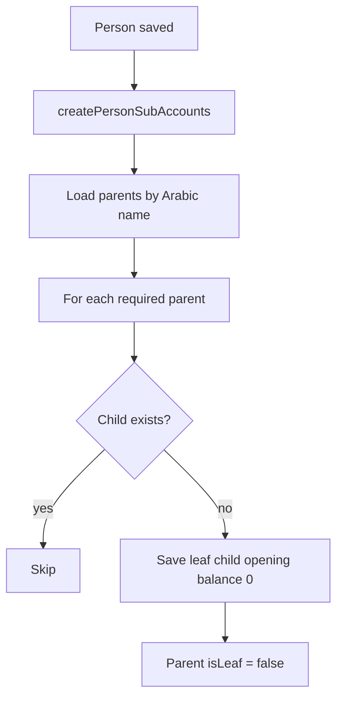

# Auto-Create Person Accounts on Create

When a **driver**, **driver assistant**, or **employee (maktab)** is created, the backend automatically provisions chart-of-accounts sub-ledgers under fixed Arabic parent accounts. Each sub-account is named after the person (`firstName lastName`). No journal entry is posted on create — only empty leaf accounts with opening balance `0`.

---

## Summary by person type

| Person type | API endpoint | Sub-accounts created |
|-------------|--------------|----------------------|
| **Driver** | `POST /api/drivers` | **عهد** + **رواتب** |
| **Driver** (inline NOLON) | `POST /api/journeys/office` | **عهد** + **رواتب** |
| **Driver assistant** | `POST /api/users` (`role: DRIVER_ASSISTANT`) | **رواتب** only |
| **Employee** | `POST /api/employees` | **عهد** + **سلف** + **رواتب** |

---

## Chart of accounts parents

Parent accounts come from the account seeder (`src/database/seeders/account/data.ts`).

| Purpose | Arabic name | Type | Normal balance | Parent in chart |
|---------|-------------|------|----------------|-----------------|
| Custody | **عهد** | ASSET | DEBIT | مدينين وارصده مدينه اخرى |
| Loan (employee advance) | **سلف** | ASSET | DEBIT | مدينين وارصده مدينه اخرى |
| Salaries | **رواتب** | LIABILITY | CREDIT | دائنين وارصده دائنه اخرى |

### Out of scope

- **ضريبه مرتبات** — not used for person sub-accounts; remains in the chart for other payroll-tax use.
- **مرتبات** — not used in this flow.

---

## Account naming

Sub-account name = `{firstName} {lastName}` (trimmed).

If the name is empty, a fallback is used:

| Role | Fallback |
|------|----------|
| Driver | `Driver {id}` |
| Driver assistant | `Assistant {id}` |
| Employee | `Employee {id}` |

Helper: `buildPersonAccountName()` in `src/app/modules/account/person-account.constants.ts`.

---

## Role → parent mapping

Defined in `PERSON_ACCOUNT_PARENTS` (`person-account.constants.ts`):

```typescript
DRIVER:           ['عهد', 'رواتب']
DRIVER_ASSISTANT: ['رواتب']
EMPLOYEE:         ['عهد', 'سلف', 'رواتب']
```

---

## Core service methods

**File:** `src/app/modules/account/account.service.ts`

### `createPersonSubAccounts(personName, parentNames, creator?, manager?)`

- Resolves each parent by Arabic `name`; throws if missing.
- Idempotent: skips creation if `{ name, parentAccount }` already exists.
- Child inherits `type` and `normalBalance` from parent via `save()`.
- **عهد** children under an ASSET parent use `type: CASH` (same as legacy custody logic).
- Opening balance `0`; no transaction lines.
- Optional `EntityManager` for use inside DB transactions.

### `findPersonSubAccount(personName, parentNameArabic, manager?)`

- Looks up a person’s sub-account by **parent Arabic name + person name** (not name alone).
- Used by journey custody transfer and employee custody balance.

### `createEmployeeCustodyAccount(employee, amount)`

- Reuses `createPersonSubAccounts` for the **عهد** child.
- Still posts the الخزينه → employee custody transaction when assigning an amount via `POST /api/employees/:id/custody`.

---

## Where provisioning runs

| File | Trigger |
|------|---------|
| `driver.controller.ts` | After `driverService.save` in `POST /api/drivers` |
| `journey-assets.service.ts` | After inline driver save in NOLON journey create |
| `user.controller.ts` | After user save when `role === DRIVER_ASSISTANT` |
| `employee.controller.ts` | After `employeeService.save` in `POST /api/employees` |

Employee and driver create paths use `withTransaction` so person + accounts are created in the same transaction where possible.

---

## Account lookups (parent-scoped)

Previously, some code used `findOne({ where: { name } })`, which breaks when one person has multiple accounts with the same name under different parents.

Updated callers:

| Location | Lookup |
|----------|--------|
| `journey.controller.ts` (office create custody) | Employee and driver accounts under **عهد** |
| `account.service.ts` `findAccountForEmployee` | Employee account under **عهد** |
| `employee.controller.ts` `assignCustody` | Verifies custody account under **عهد** |

---

## What is still separate

| Feature | Notes |
|---------|--------|
| `POST /api/salaries` | HR salary record on `salaries` table — not the chart sub-account |
| `POST /api/employees/:id/custody` | Funds the employee **عهد** account from الخزينه (requires amount) |
| Driver assistant | No **عهد** account; custody flows through the driver |

---

## Seeder setup

**رواتب** was added to `src/database/seeders/account/data.ts` under `دائنين وارصده دائنه اخرى`.

After deploying, re-run the account seeder on existing databases:

```bash
pnpm run seed
```

(Use your project’s actual seed command if different.)

When person sub-accounts are added, parents **عهد**, **سلف**, and **رواتب** become non-leaf (`isLeaf: false`) automatically via `AccountService.save`.

---

## Flow diagram



---

## Files changed

| Area | Files |
|------|-------|
| Constants | `src/app/modules/account/person-account.constants.ts` |
| Account service | `src/app/modules/account/account.service.ts` |
| Seeder | `src/database/seeders/account/data.ts`, `ACCOUNT-MINDMAP.txt` |
| Controllers | `employee.controller.ts`, `driver.controller.ts`, `user.controller.ts` |
| Journey | `journey.controller.ts`, `journey-assets.service.ts` |
| Modules | `driver.module.ts`, `user.module.ts` (import `AccountModule`) |
| Tests | `journey-assets.service.spec.ts` |

---

## Example result after create

**Driver** `Ahmed Hassan`:

```
مدينين وارصده مدينه اخرى
└── عهد
    └── Ahmed Hassan          (CASH, DEBIT, balance 0)

دائنين وارصده دائنه اخرى
└── رواتب
    └── Ahmed Hassan          (LIABILITY, CREDIT, balance 0)
```

**Employee** `Sara Ali`:

```
عهد   → Sara Ali
سلف   → Sara Ali
رواتب → Sara Ali
```

**Driver assistant** `Omar Nour`:

```
رواتب → Omar Nour
```

---

## Testing

### Unit tests (14 + journey integration)

```bash
pnpm test -- --testPathPatterns="person-accounts|journey.controller.spec|journey-assets.service.spec"
```

Covers:

- `buildPersonAccountName` and `PERSON_ACCOUNT_PARENTS` mapping
- `createPersonSubAccounts` (idempotent, عهد CASH, رواتب LIABILITY, employee triple create)
- `findPersonSubAccount` parent-scoped lookup
- `createEmployeeCustodyAccount` reuses provisioning + posts transaction
- Journey office custody uses `findPersonSubAccount` under **عهد**
- NOLON inline driver calls `createPersonSubAccounts`

### DB integration smoke test

Requires local Postgres + `pnpm run seed` first:

```bash
pnpm exec ts-node -r tsconfig-paths/register scripts/verify-person-accounts.ts
```

Verifies **عهد**, **سلف**, **رواتب** parents exist, creates employee sub-accounts, checks lookup + idempotency, then cleans up test rows.

