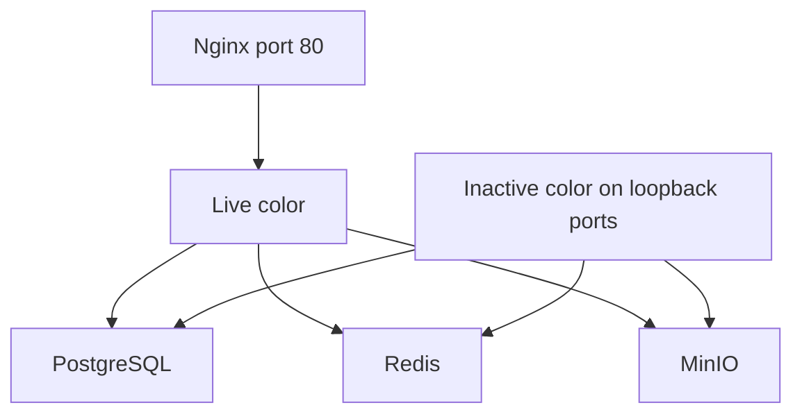

# Stage 5 — Prepare the inactive environment

Previous: [immutable release](04-immutable-release.md). Next: [pre-production validation](06-pre-production-validation.md).

## What this stage is

Blue-green means two copies of the application and one public entry point. One color is live. The release is started on the other color. Shared data services stay up and are not recreated.

If blue is live, this stage starts green with the new digest. If green is live, it starts blue. It does not replace, recreate, or restart the live application containers.

Host ports exist so stage 6 can call the inactive color directly. They bind to `127.0.0.1` on the VPS, so the internet still has only Nginx port 80.

| Color | Backend loopback | Frontend loopback | Docker DNS |
| --- | --- | --- | --- |
| Blue | `127.0.0.1:18080` | `127.0.0.1:13000` | `backend-blue:8080`, `frontend-blue:3000` |
| Green | `127.0.0.1:28080` | `127.0.0.1:23000` | `backend-green:8080`, `frontend-green:3000` |

Inside the network both backends listen on 8080 and both frontends on 3000. The host ports differ so the two colors can run at once.

## Where Red Sea is today

Compose has a single `backend` service and a single `frontend` service, built from source, with no host ports. Nginx upstreams are hard-coded to `frontend:3000` and `backend:8080` in [deployment/nginx/nginx.conf](../../../deployment/nginx/nginx.conf). Postgres, Redis, and MinIO already have healthchecks. The app containers do not.

There is no RabbitMQ service. Do not add one. BullMQ uses the existing Redis.

Both colors will share one database. [backend/src/config/db-config.ts](../../../backend/src/config/db-config.ts) runs migrations on startup (`migrationsRun` defaults to true) and can synchronize the schema when `DATABASE_SYNCHRONIZE` is true. On the VPS, synchronize stays false. The new color applies migrations while the old color is still serving, so each migration has to work with the previous release still running: add columns and tables first, and leave drops and renames for a later release after the old color is gone.

## Plan for this stage

Split Compose into three files.

- [deployment/docker-compose.yml](../../../deployment/docker-compose.yml) keeps `postgres`, `redis`, `minio`, `minio-init`, and `nginx`. Images only. Nginx mounts a generated upstream file (stage 7) as well as the static config.
- `deployment/docker-compose.apps.yml` defines `backend-blue`, `backend-green`, `frontend-blue`, and `frontend-green`. Each service’s image is the digest (`${BACKEND_IMAGE}`, `${FRONTEND_IMAGE}`). Loopback ports are the table above. They join the same `redsea` network and use the same env file, plus `APP_COLOR` and `APP_RELEASE_SHA`.
- `deployment/docker-compose.local.yml` keeps today’s build contexts so a workstation can still run `docker compose up --build`.

The deploy script reads `/opt/redsea/state/active.json`. It starts only the other color. When that file is missing (first boot), it prepares blue and stage 7 will make blue live.

Add Docker healthchecks on the four app services. They call the health routes from stage 6. `depends_on` for the app services waits until Postgres, Redis, and MinIO are healthy. Nginx does not list the app services as hard dependencies, so it can keep running while one color is stopped.

## Done when

- A second release starts the idle color and leaves the live containers’ ids unchanged.
- Shared Postgres, Redis, and MinIO are not recreated.
- The idle app is reachable on the loopback ports and is not reachable from the public internet.
- Local `docker compose up --build` still builds from the repo.

## Files

- `deployment/docker-compose.yml`
- `deployment/docker-compose.apps.yml`
- `deployment/docker-compose.local.yml`
- `deployment/.env.example` (`APP_COLOR`, image digest variables, `DATABASE_SYNCHRONIZE=false`)
- Deploy script that selects the inactive color (used by the release workflow over SSH)
