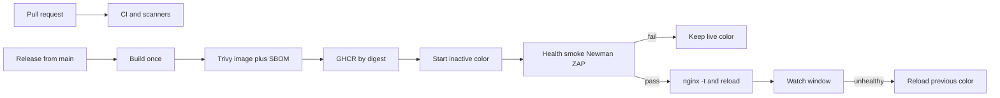

# Release pipeline — learning notes

Read these in order. Each note teaches one stage, then states the Red Sea plan for that stage. Together they are the plan for the new VPS: GitHub Actions builds and scans, GHCR stores one image digest, and the VPS only pulls that digest and switches Nginx.

The app today is two pnpm projects, [backend](../../../backend/package.json) and [frontend](../../../frontend/package.json), started from [deployment/docker-compose.yml](../../../deployment/docker-compose.yml) behind [deployment/nginx/nginx.conf](../../../deployment/nginx/nginx.conf). There is no CI, no container registry, and no application health route. One backend container and one frontend container serve traffic. Shared services are PostgreSQL, Redis, and MinIO. Queues use Redis and BullMQ.

Production is a new Linux VPS. A GitHub Release cut from `main`, or a manual workflow run on `main`, starts a deploy. The GitHub Environment `production` must be approved before that deploy job runs.

## Stages

1. [Source control and release approval](01-source-control-and-release-approval.md)
2. [Code quality and automated tests](02-code-quality-and-tests.md)
3. [Vulnerability audit](03-vulnerability-audit.md)
4. [Build and publish an immutable release](04-immutable-release.md)
5. [Prepare the inactive environment](05-inactive-environment.md)
6. [Pre-production validation](06-pre-production-validation.md)
7. [Atomic traffic switch](07-atomic-traffic-switch.md)
8. [Post-deployment monitoring and rollback](08-monitoring-and-rollback.md)

## What stays the same across stages

- GitHub-hosted runners build and scan. The VPS does not compile the app during a deploy.
- Application secrets live in `/opt/redsea/.env` on the VPS. The workflow only receives `DEPLOY_HOST`, `DEPLOY_USER`, and `DEPLOY_SSH_KEY`.
- A high or critical dependency advisory fails the security stage. Image CVEs do not block the release.
- A failed check before the Nginx reload leaves the current color serving traffic.
