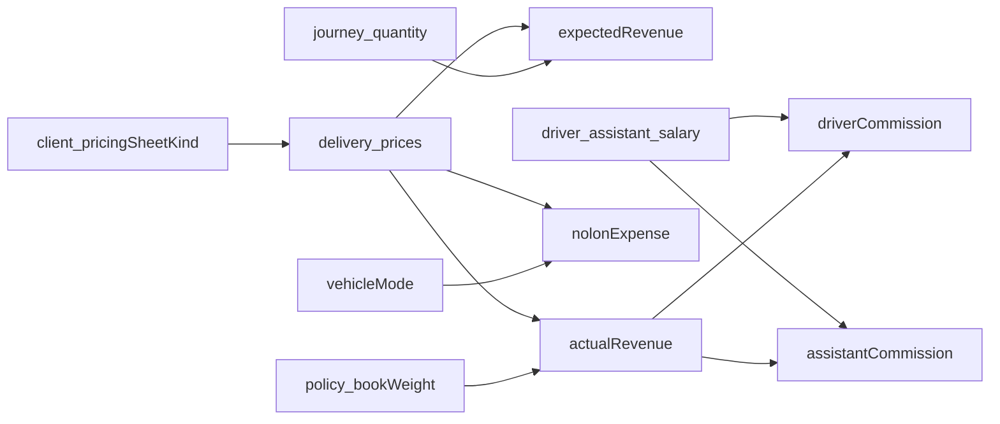

# 15 — Journey trip values (revenue, sheet kind, nolon)

Standalone source of truth for how a trip’s money is calculated. Implementation can follow this file without the Cursor plan.

## Goal

- Price every factory with an explicit sheet style (`ARISH` | `WATANIA`), not hardcoded client ids `1` / `2`.
- Expected revenue may be written at **delegation** when a delivery area is known (optional on create) or whenever quantity/packing/client/area changes and an area can be resolved.
- Actual revenue is written only on **policy** create/update (`x × bookWeight`).
- Put **نولون** (`nolonPrice`) on each sheet row — **only** sheet field for all nolon/commission money. Used as:
  - one-time pay for **`NOLON_CAR` / `CONTRACT_CAR`**, and
  - trip commission / nolon pay for salary schemes **شهري / كومسيون / نولون** (when the car is not already nolon/contract — avoid double post).
- Journey list: **نوع الرحلة** (`car.ownerShip`), **نولون** (nolon-related expense sum), **إجمالي المصروفات** (all expense txs).
- Driver / assistant salary schemes: شهري = monthly + daily; كومسيون = daily + sheet nolon; نولون = sheet nolon only (selector).
- Leave own-car on-road expenses for a later discussion.

## Prerequisites

- Client delivery prices already exist (`delivery_prices`, area, packing type, validity).
- Journey has `quantity` and `packingType` at delegation; policy has `bookWeight` and `deliveryArea`.
- Vehicle modes: `NOLON_CAR`, `CONTRACT_CAR`, `COMPANY_CAR`.

## Trip value overview

| Value | Formula | When |
| --- | --- | --- |
| Unit price `x` | From the matching **client sheet row** | When dest (area) + date can resolve a row |
| Expected revenue | `x × journey.quantity` | When `x` is known |
| Actual revenue | `x × policy.bookWeight` | Policy create / update |
| مطالبة (Watania) | مصاريف الرحلة والطريق والخدمات, per ton, inside billed `x` | Expense amount = `مطالبة × load` (own cars later) |
| Nolon expense | Sheet `nolonPrice` as-is (one-time, not × load) | Auto on policy: nolon/contract cars **or** salary schemes شهري/كومسيون/نولون (not both) |
| Daily work expense | Salary `dailyWorkPrice` | Policy save for `MONTHLY` / `COMMISSION` |
| Profit (later) | `actualRevenue − expenses` | After expenses exist |

**Tax:** use the **sheet money value** (`taxPrice`). Do **not** add client `taxApplies` / `taxPercent`.

**No `journey_revenues` table.** Persist columns on `clients`, `journeys`, and `delivery_prices`.



---

## 1. Client sheet kind

Required on **create and edit** of any client.

```
enum PricingSheetKind {
  ARISH = 'ARISH'       // 5 packing-type columns (العريش + any other factory)
  WATANIA = 'WATANIA'   // مطالبة + سعر الطن + ضريبة + نولون
}
```

| Rule | Detail |
| --- | --- |
| Required | No silent default on create — user picks the style |
| Backfill | Existing `id = 2` → `WATANIA`; everyone else → `ARISH` |
| UI | Price-sheet tables, forms, Excel import/export follow `client.pricingSheetKind` |
| Stop | Hardcoded `ARISH_CLIENT_ID = '1'` / `WATANEYA_CLIENT_ID = '2'` |

### Files

| File | Work |
| --- | --- |
| `backend/src/core/enums/pricing-sheet-kind.ts` | New enum |
| `backend/src/app/modules/factory/client.entity.ts` | Column `pricingSheetKind` NOT NULL |
| `backend/src/app/modules/factory/dtos/client.dto.ts` | Required `@IsEnum` |
| `backend/src/app/modules/factory/client.mapper.ts` | Map create/update/list |
| `backend/src/app/modules/factory/client.controller.ts` | Include in GET select lists |
| Migration | Add column, backfill, set NOT NULL |
| `frontend/src/features/clients/types/create-schema.ts` | Required field |
| `frontend/src/features/clients/components/client-form.tsx` | Select ARISH / WATANIA |
| `frontend/src/features/clients/components/client-page-client.tsx` | Branch on kind, not id |
| `frontend/src/app/[locale]/(loggedIn)/clients/[clientId]/delivery-prices/create/page.tsx` | Same |

---

## 2. How to find sheet row (`x` and nolon)

Same lookup for revenue unit price and nolon:

| Key | Source |
| --- | --- |
| Client | `journey.client_id` |
| Area (gov / city) | Policy `deliveryArea`, or optional `deliveryAreaId` on office create (seeds expected only; not stored on journey) |
| Date | `policy.tripDate` (fallback: policy date / today / create date) inside `[validFrom, validTo]` |
| Packing type | `journey.packingType` — **required for `ARISH`**; Watania rows are typically one type (BAGGED) per area |

If several rows match, take the latest `validFrom`.

**Write timing**

- **Expected:** when area is known at office create (optional dest) or on journey update (qty / packing / client / area) via `applyExpected`.
- **Actual + nolon expense + commissions:** on policy create/update via `applyFromPolicy`.
- If create has **no** area → expected stays null until policy (or an update that can resolve area).

---

## 3. Revenue (expected / actual)

### Shared

```
carLoad for expected = journey.quantity          // delegation planned load
carLoad for actual   = policy.bookWeight         // confirmed load
expectedRevenue      = x * quantity
actualRevenue        = x * bookWeight
coalescedRevenue     = COALESCE(actualRevenue, expectedRevenue)   // stats / profit / logistics only
```

### وطنية (`WATANIA`)

Sheet columns: gov, city, مطالبة, سعر الطن, ضريبة (value), **نولون**, total.

**مطالبة** = مصاريف الرحلة والطريق والخدمات (trip + road + services). It is **per ton**, stored as `additionalFees`. The client is still billed for it, so it stays inside `x`:

```
x = مطالبة + سعر_الطن + ضريبة
  = additionalFees + basePrice + taxPrice
```

Prefer stored `totalPrice` when it is kept in sync with that sum.

**نولون is not in `x`.** Nolon is driver one-time pay, not these road/services costs.

When we post expenses, the road/services amount is `مطالبة × load` (`additionalFees × bookWeight` / quantity). Do not confuse that with nolon. Own-car on-road later should use this مطالبة figure, not `nolonPrice`.

### العريش + any other factory (`ARISH`)

Sheet columns: gov, city, سليو 10, معبأ, سايب, سليو 12, جامبو معبأ, plus **نولون** on the row.

```
x = price of the packing type chosen on delegation create
  = that row's basePrice (or totalPrice if that is how the type is stored)
```

No مطالبة / tax in this mode unless those amounts are already inside the type cell.

### Persist on the journey

| Column | Meaning | Write when |
| --- | --- | --- |
| `expectedRevenue` | Planned: `x × quantity` | When `x` can be resolved (office create with area, journey update, or policy) |
| `actualRevenue` | Confirmed: `x × bookWeight` | Policy create / update only |

Optional helper: `unitPrice` (`x`) so both numbers stay explainable. **Not required.**

**UI / API display**

| Surface | What to show |
| --- | --- |
| Journey **list** tables (`JourneyList`) | `expectedRevenue` + `actualRevenue` only — **no** coalesced **إجمالي الإيراد** column |
| Journey **list** expenses | **إجمالي المصروفات** = sum of all expense `journey_transactions`; **نولون** = sum of sheet-nolon expense categories (`Nolon Fees`, `Driver Commission`, `Assistant Commission`); **نوع الرحلة** = `car.ownerShip` |
| Trip **info** detail | Both expected and actual |
| Logistics | **إجمالي الايراد** = coalesced policy revenue |
| List **profit** | `COALESCE(actual, expected) −` sum of expense txs |
| Client / branch **KPI cards** | Scoped `GET /journeys/stats`: `totalRevenue` / `totalExpenses` / `totalProfit` |

Do **not** keep a live sheet join for list revenue that changes when the sheet is edited later.

### Files

| File | Work |
| --- | --- |
| `backend/src/app/modules/journey/journey.entity.ts` | `expectedRevenue`, `actualRevenue` nullable decimal |
| `backend/src/app/modules/journey/dtos/journey.dto.ts` | Expose both |
| `backend/src/app/modules/journey/journey-revenue.calculator.ts` | Pure `x`, expected, actual |
| `backend/src/app/modules/journey/journey-revenue.service.ts` | Lookup row + write columns |
| `backend/src/app/modules/journey-goods/journey-policy.controller.ts` | Call writer on create/update |
| `backend/src/app/modules/journey/journey-list-query.builder.ts` | Read stored columns |
| `backend/src/app/modules/journey/journey.service.ts` | Detail JSON: same stored values |

---

## 4. Nolon price on the sheet (expense, not revenue)

**One sheet field for all nolon / commission money:** `nolonPrice` (**نولون**). Fixed EGP, not %, not part of billed `x`, not × load.

| Use | When |
| --- | --- |
| `Nolon Fees` | Car is `NOLON_CAR` or `CONTRACT_CAR` |
| Trip commission / nolon for salary | Salary type is `MONTHLY`, `COMMISSION`, or `NOLON_PERCENT` **and** car is **not** nolon/contract (same amount must not post twice) |

`employeeNolonAmount` is **deprecated**: removed from sheet UI (forms, tables, Excel). DB column may still exist unused — do not drop in this work; do not send from FE.

### Files

| File | Work |
| --- | --- |
| `delivery-price.entity.ts` + DTOs + mapper | `nolonPrice` (only money field for nolon) |
| Arish / Watania forms + tables + Excel | نولون column only |
| `journey-revenue.service.ts` | Apply on policy save |
| `journey-list-query.builder.ts` | `vehicleType` = `car.ownerShip`; `nolonExpense` from nolon-related expense txs |

---

## 5. Driver and assistant pay from salary

| Scheme (UI) | Enum | Salary form | Policy expenses |
| --- | --- | --- | --- |
| شهري | `MONTHLY` | `salaryAmount` + `dailyWorkPrice` | Daily work + sheet `nolonPrice` (if not already NOLON_FEES) |
| كومسيون | `COMMISSION` | `dailyWorkPrice` only | Daily work + sheet `nolonPrice` (if not already NOLON_FEES) |
| نولون | `NOLON_PERCENT` | **None** (selector only) | Sheet `nolonPrice` only (if not already NOLON_FEES) |

Do **not** use salary `commissionPerJourney` / `%` for trip commission — that comes from sheet `nolonPrice`.

### Files

| File | Work |
| --- | --- |
| Driver / assistant salary form | Scheme fields as above |
| `journey-revenue.service.ts` | Branch on `salaryType` + ownership |

---

## 6. Field mapping (sheet → DB)

| Arabic / UI | DB | Used in |
| --- | --- | --- |
| محافظة / مدينة | `area` → government + area | Lookup |
| مطالبة (مصاريف الرحلة والطريق والخدمات) | `additionalFees` | Watania `x` (billed) and road/services expense (`× load`) |
| سعر الطن | `basePrice` | Watania `x`; Arish type cell |
| ضريبة / ض ق م | `taxPrice` (money, not %) | Watania `x` |
| اجمالي (إيراد الوحدة) | `totalPrice` | Watania `x` if synced |
| نولون | `nolonPrice` | **Only** nolon/commission money: nolon/contract car fees **and** salary-scheme trip commission |
| ~~مبلغ ناولون الموظف~~ | `employeeNolonAmount` | **Deprecated / unused** — removed from sheet UI; DB column may remain |
| سعر يوم العمل | `salaries.dailyWorkPrice` | Trip expense for `MONTHLY` / `COMMISSION` |
| سليو 10 / معبأ / سايب / سليو 12 / جامبو | `price_types.name` + `journey.packingType` | Arish `x` |
| الكمية | `journeys.quantity` | Expected revenue |
| الوزن الدفتري | `journey_policies.bookWeight` | Actual revenue |
| نوع التعبئة | `journeys.packingType` | Arish lookup |
| أسلوب الشيت | `clients.pricingSheetKind` | Which formula + which UI |

Packing type enums (existing): `SILO10`, `BAGGED`, `LOOSE`, `SILO12`, `JUMBO_BAG`.

---

## 7. Current state (shipped)

- Sheet kind on the client (`ARISH` | `WATANIA`); sheet UI follows kind, not client ids.
- Backend writes `expectedRevenue` / `actualRevenue` (early expected when area known; actual on policy).
- Journey lists show **expected** + **actual** columns (not a separate coalesced total column).
- Sheet has `nolonPrice` as the **only** nolon/commission money field for nolon/contract cars **and** شهري/كومسيون/نولون salary trip pay (no double post).
- Salary: `MONTHLY` = salary + daily; `COMMISSION` = daily; `NOLON_PERCENT` = selector only (sheet nolon).
- `employeeNolonAmount` removed from sheet UI; DB column unused (no drop).
- Journey list shows **نوع الرحلة** (`car.ownerShip`), **نولون** (`nolonExpense`), and **إجمالي المصروفات** (all expense txs).
- Client / branch money cards use scoped journey stats (`totalRevenue` / expenses / profit).
- Tax stays a sheet money value (`taxPrice`); do not move tax to client `%` flags.

---

## Checklist

- [x] `PricingSheetKind` enum + client column + backfill
- [x] Create/edit client requires sheet kind
- [x] Price sheets / Excel / create-price page use kind, not ids
- [x] `nolonPrice` on `delivery_prices` + both sheet UIs + Excel
- [x] Journey `expectedRevenue` / `actualRevenue` columns
- [x] Writer: expected on create/update when area known; actual + expenses on policy
- [x] List/detail use stored expected + actual (no coalesced total list column)
- [x] Salary schemes mapped: MONTHLY / COMMISSION / NOLON_PERCENT vs sheet `nolonPrice`
- [x] Sheet UI uses `nolonPrice` only (`employeeNolonAmount` removed from FE)
- [x] List columns: نوع الرحلة + نولون + إجمالي المصروفات
- [x] Client / branch KPI cards from `/api/journeys/stats`
- [x] This file stays the formula source of truth

## Done when

- Any new factory can be Arish-style or Watania-style.
- A trip with a policy shows stable actual revenue after the sheet later changes.
- Nolon/contract and salary schemes use sheet `nolonPrice` without double-posting.
- Lists show expected vs actual clearly; stats/profit still use coalesce under the hood.

## Out of scope

- Own-car (`COMPANY_CAR`) wiring of مطالبة as on-road / services expense (the meaning is defined; apply later)
- Client-level tax % flags
- New `journey_revenues` entity
- Full profit product (beyond existing list: stored actual − expense txs)

## Related

- [07-client.md](./07-client.md) — client info / journeys tab
- [01-journey.md](./01-journey.md) — workflow statuses
- [02-driver.md](./02-driver.md) / [03-driver-assistant.md](./03-driver-assistant.md) — trip commission is the salary on the driver user and assistant user
- [00-shared-foundation.md](./00-shared-foundation.md) — list columns including revenue
