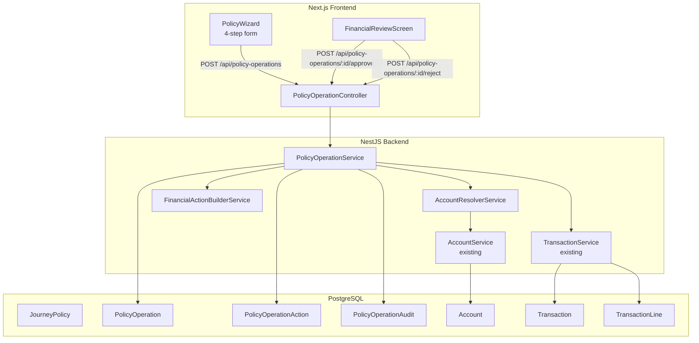
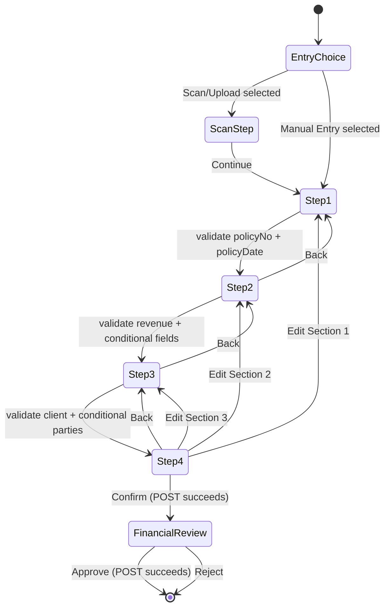

# Design Document — Policy Operations & Financial Actions

## Overview

Phase 2 introduces a structured **Policy Creation Wizard** in the Office screens that links policy data entry to automatic financial action generation. An office user creates a policy through a 4-step wizard, confirms the data, and the backend builds proposed journal entries (TRN1 always, TRN2 and TRN3 conditionally). A **Financial Review Screen** displays these proposals to an approver before any posting occurs. On approval, all transactions post atomically to the existing financial module.

The feature is a thin orchestration layer on top of existing infrastructure: it uses `AccountService.save()` for account resolution, `TransactionService.save()` for posting, and the seeded Chart of Accounts as the anchor tree. No new financial infrastructure is introduced.

### Key Design Decisions

- **Propose-then-post model**: The backend builds and persists `PolicyOperationAction` rows (proposed journal lines) at creation time. Posting only happens on explicit `POST /api/policy-operations/:id/approve`. This allows the review screen to show computed lines without side-effects.
- **Account resolver as pure traversal**: `AccountResolverService` resolves paths by name at each level, creating missing branches/leaves using `AccountService.save()`. Account IDs are never hardcoded.
- **Atomic approval**: All TRNs for an operation post in a single database transaction. Partial success is not allowed.
- **Append-only audit**: `PolicyOperationAudit` records are insert-only; no updates ever touch existing rows.

---

## Architecture



### Request Flow — Create Operation

1. Wizard submits `POST /api/policy-operations` with all wizard data.
2. `PolicyOperationService.create()` resolves all required accounts via `AccountResolverService`.
3. `FinancialActionBuilderService.build()` computes the list of proposed `PolicyOperationAction` rows (TRN groups, amounts, debit/credit).
4. `PolicyOperation` + `PolicyOperationAction` rows are saved. Status = `PENDING_REVIEW`.
5. An initial audit entry is appended.
6. Response returns the operation with proposed actions. Frontend navigates to `FinancialReviewScreen`.

### Request Flow — Approve

1. `POST /api/policy-operations/:id/approve`.
2. Service re-validates debit/credit balance across all actions.
3. Each TRN group is posted via `TransactionService.save()` in a single database transaction (EntityManager).
4. Status updated to `POSTED`, audit entry appended.

---

## Components and Interfaces

### Backend: `policy-operation` Module

#### Entities

```typescript
// policy-operation.entity.ts
@Entity('policy_operations')
export class PolicyOperation extends BaseEntity {
  @ManyToOne(() => JourneyPolicy) journeyPolicy: JourneyPolicy;
  @Column({ type: 'enum', enum: OperationType }) operationType: OperationType;
  @Column({ nullable: true }) contractType?: ContractType;
  @Column({ nullable: true }) transactionType?: TransactionType;
  @Column({ type: 'decimal', precision: 14, scale: 2 }) totalRevenue: number;
  @Column({ type: 'decimal', precision: 14, scale: 2, nullable: true }) totalExpenses?: number;
  @Column({ type: 'decimal', precision: 14, scale: 2, nullable: true }) custodyAmount?: number;
  @Column({ nullable: true }) custodySourceType?: CustodySourceType; // OFFICE | SUPPLIER
  @Column({ nullable: true }) clientId?: number;
  @Column({ nullable: true }) supplierId?: number;       // transport supplier
  @Column({ nullable: true }) custodySupplierId?: number;
  @Column({ nullable: true }) contractRef?: string;
  @Column({ nullable: true }) contractDate?: Date;
  @Column({ nullable: true }) nolonRef?: string;
  @Column({ type: 'enum', enum: PolicyOperationStatus }) status: PolicyOperationStatus;
  @OneToMany(() => PolicyOperationAction, (a) => a.operation) actions: PolicyOperationAction[];
  @OneToMany(() => PolicyOperationAudit, (a) => a.operation) audits: PolicyOperationAudit[];
}

// policy-operation-action.entity.ts
@Entity('policy_operation_actions')
export class PolicyOperationAction extends BaseEntity {
  @ManyToOne(() => PolicyOperation) operation: PolicyOperation;
  @Column() accountId: number;
  @Column() accountName: string;
  @Column() accountPath: string;          // e.g. "الإيرادات / إيرادات تحت التنفيذ / {client}"
  @Column({ type: 'enum', enum: EntryType }) entryType: EntryType;
  @Column({ type: 'decimal', precision: 14, scale: 2 }) amount: number;
  @Column() trnGroup: string;             // "TRN1" | "TRN2" | "TRN3"
  @Column() reason: string;
  @Column({ type: 'enum', enum: ActionStatus }) status: ActionStatus; // PENDING | POSTED | REJECTED
  @Column({ nullable: true }) postedTransactionCode?: string;
}

// policy-operation-audit.entity.ts — INSERT ONLY
@Entity('policy_operation_audits')
export class PolicyOperationAudit extends BaseEntity {
  @ManyToOne(() => PolicyOperation) operation: PolicyOperation;
  @Column() eventType: string;   // CREATED | APPROVED | REJECTED
  @Column() actorUserId: number;
  @Column({ type: 'jsonb' }) snapshot: Record<string, unknown>;
  @Column() timestamp: Date;
}
```

#### Enums

```typescript
enum OperationType   { CONTRACT = 'عقد' }
enum ContractType    { NOLON = 'نولون' }
enum TransactionType { CUSTODY = 'عهدة', NORMAL = 'normal' }
enum CustodySourceType { OFFICE = 'OFFICE', SUPPLIER = 'SUPPLIER' }
enum PolicyOperationStatus { PENDING_REVIEW = 'PENDING_REVIEW', POSTED = 'POSTED', REJECTED = 'REJECTED' }
enum ActionStatus    { PENDING = 'PENDING', POSTED = 'POSTED', REJECTED = 'REJECTED' }
```

#### `AccountResolverService`

Resolves an ordered array of account name segments into a leaf `Account`, creating missing intermediates along the way.

```typescript
@Injectable()
export class AccountResolverService {
  constructor(private readonly accountService: AccountService) {}

  /**
   * Traverses (or creates) accounts along `segments` path.
   * - segments[0] must be an existing seeded root account.
   * - All intermediate segments are created with isLeaf=false if missing.
   * - The final segment is created with isLeaf=true if missing.
   * Returns the resolved leaf Account.
   */
  async resolve(
    segments: string[],
    manager?: EntityManager,
  ): Promise<Account> {
    if (segments.length < 2) {
      throw new BadRequestException('Account path must have at least 2 segments');
    }

    // Find root (must exist — seeded)
    let current = await this.findByNameAndParent(segments[0], null, manager);
    if (!current) {
      throw new NotFoundException(
        `Root account "${segments[0]}" not found in chart of accounts`,
      );
    }

    for (let i = 1; i < segments.length; i++) {
      const isLeaf = i === segments.length - 1;
      const existing = await this.findByNameAndParent(segments[i], current.id, manager);
      if (existing) {
        current = existing;
      } else {
        const child = new Account();
        child.name = segments[i];
        child.parentAccount = current;
        child.isLeaf = isLeaf;
        current = await this.accountService.save(child, undefined, manager);
      }
    }

    return current;
  }

  private async findByNameAndParent(
    name: string,
    parentId: number | null,
    manager?: EntityManager,
  ): Promise<Account | undefined> {
    const repo = manager?.getRepository(Account) ?? this.accountRepository;
    return repo.findOne({
      where: parentId === null
        ? { name, parentAccount: IsNull() }
        : { name, parentAccount: { id: parentId } },
      relations: ['parentAccount'],
    }) ?? undefined;
  }
}
```

#### `FinancialActionBuilderService`

Builds the list of `PolicyOperationAction` objects for a given operation. Pure computation — no DB writes.

```typescript
@Injectable()
export class FinancialActionBuilderService {
  /**
   * Returns proposed action rows for TRN1 (always), TRN2 (عقد+نولون), TRN3 (عهدة).
   * Accounts are pre-resolved and passed in as ResolvedAccounts.
   */
  build(input: BuildInput): ProposedAction[] {
    const actions: ProposedAction[] = [];

    // TRN1: Revenue recognition — always
    actions.push({
      accountId: input.clientAssetAccountId,
      accountName: input.clientAssetAccountName,
      accountPath: input.clientAssetAccountPath,
      entryType: EntryType.DEBIT,
      amount: input.totalRevenue,
      trnGroup: 'TRN1',
      reason: `إيراد تحت التنفيذ — ${input.clientName}`,
    });
    actions.push({
      accountId: input.revenueAccountId,
      accountName: input.revenueAccountName,
      accountPath: input.revenueAccountPath,
      entryType: EntryType.CREDIT,
      amount: input.totalRevenue,
      trnGroup: 'TRN1',
      reason: `إيراد تحت التنفيذ — ${input.clientName}`,
    });

    // TRN2: Freight expense — عقد + نولون only
    if (input.operationType === 'عقد' && input.contractType === 'نولون') {
      actions.push({
        accountId: input.freightExpenseAccountId,
        accountName: input.freightExpenseAccountName,
        accountPath: input.freightExpenseAccountPath,
        entryType: EntryType.DEBIT,
        amount: input.totalExpenses!,
        trnGroup: 'TRN2',
        reason: `مصروف نولون — ${input.supplierName}`,
      });
      actions.push({
        accountId: input.supplierLiabilityAccountId,
        accountName: input.supplierLiabilityAccountName,
        accountPath: input.supplierLiabilityAccountPath,
        entryType: EntryType.CREDIT,
        amount: input.totalExpenses!,
        trnGroup: 'TRN2',
        reason: `التزام مورد النقل — ${input.supplierName}`,
      });
    }

    // TRN3: Custody movement — عقد + نولون + عهدة
    if (
      input.operationType === 'عقد' &&
      input.contractType === 'نولون' &&
      input.transactionType === 'عهدة'
    ) {
      actions.push({
        accountId: input.custodyDebitAccountId,
        accountName: input.custodyDebitAccountName,
        accountPath: input.custodyDebitAccountPath,
        entryType: EntryType.DEBIT,
        amount: input.custodyAmount!,
        trnGroup: 'TRN3',
        reason: `تحويل عهدة — ${input.custodySourceLabel}`,
      });
      actions.push({
        accountId: input.custodyCreditAccountId,
        accountName: input.custodyCreditAccountName,
        accountPath: input.custodyCreditAccountPath,
        entryType: EntryType.CREDIT,
        amount: input.custodyAmount!,
        trnGroup: 'TRN3',
        reason: `تحويل عهدة — ${input.custodySourceLabel}`,
      });
    }

    return actions;
  }
}
```

#### API Endpoints

| Method | Path | Description |
|--------|------|-------------|
| `POST` | `/api/policy-operations` | Create operation, resolve accounts, build actions |
| `GET` | `/api/policy-operations/:id` | Get operation with actions |
| `POST` | `/api/policy-operations/:id/approve` | Validate balance, post all TRNs atomically |
| `POST` | `/api/policy-operations/:id/reject` | Reject, append audit entry |
| `GET` | `/api/policy-operations/:id/audit` | Retrieve audit trail |

##### `POST /api/policy-operations` — Request DTO

```typescript
interface CreatePolicyOperationDto {
  journeyPolicyId: number;

  // Step 1 — Document data (creates/updates JourneyPolicy)
  policyNo: string;
  policyDate: string;         // ISO date
  loadingDate?: string;
  archiveNo?: string;
  deliveryGovId?: number;
  deliveryAreaId?: number;
  bookWeight?: number;
  actualWeight?: number;
  deliveryWeight?: number;
  shortageQty?: number;
  employeeId?: number;

  // Step 2 — Operation data
  operationType: string;      // 'عقد'
  contractType?: string;      // 'نولون'
  transactionType?: string;   // 'عهدة' | 'normal'
  totalRevenue: number;
  totalExpenses?: number;
  custodyAmount?: number;

  // Step 3 — Parties
  clientId: number;
  supplierId?: number;
  custodySourceType?: 'OFFICE' | 'SUPPLIER';
  custodySupplierId?: number;
  contractRef?: string;
  contractDate?: string;
  nolonRef?: string;
}
```

##### `POST /api/policy-operations` — Response

```typescript
interface PolicyOperationResponse {
  id: number;
  status: 'PENDING_REVIEW';
  journeyPolicyId: number;
  actions: PolicyOperationActionDto[];
  totalDebit: number;
  totalCredit: number;
  createdAt: string;
}

interface PolicyOperationActionDto {
  id: number;
  accountId: number;
  accountName: string;
  accountPath: string;
  entryType: 'DEBIT' | 'CREDIT';
  amount: number;
  trnGroup: string;
  reason: string;
  status: 'PENDING';
}
```

---

### Frontend: `policy-wizard` Feature

#### Directory Layout

```
src/features/policy-wizard/
  api/
    create-policy-operation.ts    — useCreatePolicyOperation
    approve-policy-operation.ts   — useApprovePolicyOperation
    reject-policy-operation.ts    — useRejectPolicyOperation
    get-policy-operation.ts       — useGetPolicyOperation
  components/
    policy-wizard.tsx             — 4-step wizard + entry choice
    policy-entry-choice.tsx       — Scan/Upload vs Manual Entry cards
    policy-scan-step.tsx          — dummy file upload UI
    policy-step-1-document.tsx    — بيانات الوثيقة form
    policy-step-2-operation.tsx   — بيانات العملية (conditional fields)
    policy-step-3-parties.tsx     — الأطراف (conditional party fields)
    policy-step-4-review.tsx      — read-only summary with edit shortcuts
    financial-review-screen.tsx   — proposed actions, approve/reject
    financial-action-lines-table.tsx — journal lines table
  hooks/
    use-policy-wizard-form.ts     — combined form state + submission
  types/
    policy-wizard-schema.ts       — Zod schemas per step + combined
  enums/
    operation-type.ts
```

#### Route

```
src/app/[locale]/(loggedIn)/office/policy/[journeyId]/create/page.tsx
```

The page receives `journeyId` from the URL, fetches the journey to pre-populate the client, and renders `PolicyWizard`.

#### Wizard State Machine



#### Zod Schemas

```typescript
// policy-wizard-schema.ts

export const step1Schema = z.object({
  policyNo: z.string().min(1, 'رقم البوليصة مطلوب'),
  policyDate: z.string().min(1, 'تاريخ البوليصة مطلوب'),
  loadingDate: z.string().optional(),
  archiveNo: z.string().optional(),
  deliveryGovId: z.string().optional(),
  deliveryAreaId: z.string().optional(),
  bookWeight: z.string().optional(),
  actualWeight: z.string().optional(),
  deliveryWeight: z.string().optional(),
  shortageQty: z.string().optional(),
  employeeId: z.string().optional(),
});

export const step2Schema = z.object({
  operationType: z.string().min(1, 'نوع العملية مطلوب'),
  contractType: z.string().optional(),
  transactionType: z.string().optional(),
  totalRevenue: z.string().refine((v) => Number(v) > 0, 'إجمالي الإيراد يجب أن يكون أكبر من صفر'),
  totalExpenses: z.string().optional(),
  custodyAmount: z.string().optional(),
}).superRefine((v, ctx) => {
  if (v.operationType === 'عقد' && v.contractType === 'نولون') {
    if (!v.totalExpenses || Number(v.totalExpenses) <= 0) {
      ctx.addIssue({ code: z.ZodIssueCode.custom, message: 'إجمالي المصروفات مطلوب', path: ['totalExpenses'] });
    }
  }
  if (v.transactionType === 'عهدة') {
    if (!v.custodyAmount || Number(v.custodyAmount) <= 0) {
      ctx.addIssue({ code: z.ZodIssueCode.custom, message: 'قيمة العهدة مطلوبة', path: ['custodyAmount'] });
    }
  }
});

export const step3Schema = z.object({
  clientId: z.string().min(1, 'العميل مطلوب'),
  supplierId: z.string().optional(),
  custodySourceType: z.enum(['OFFICE', 'SUPPLIER']).optional(),
  custodySupplierId: z.string().optional(),
  contractRef: z.string().optional(),
  contractDate: z.string().optional(),
  nolonRef: z.string().optional(),
}).superRefine((v, ctx) => {
  // supplierId required when contractType=نولون (passed via combined schema context)
});

export const wizardSchema = step1Schema.merge(step2Schema).merge(step3Schema);
export type WizardFormValues = z.infer<typeof wizardSchema>;
```

#### `FinancialReviewScreen` Component

Receives the `PolicyOperationResponse` (from the `POST /api/policy-operations` response or `GET /api/policy-operations/:id`) and renders:
- Grouped journal lines by `trnGroup` (TRN1, TRN2, TRN3)
- Total debit / total credit summary row
- Approve / Reject buttons with loading states
- Error display if backend rejects the approval

---

## Data Models

### New Database Tables

```
policy_operations
  id, created_at, updated_at, created_by, updated_by
  journey_policy_id        FK → journey_policies.id
  operation_type           varchar(50)
  contract_type            varchar(50) nullable
  transaction_type         varchar(50) nullable
  total_revenue            decimal(14,2)
  total_expenses           decimal(14,2) nullable
  custody_amount           decimal(14,2) nullable
  custody_source_type      varchar(20) nullable
  client_id                int nullable
  supplier_id              int nullable
  custody_supplier_id      int nullable
  contract_ref             varchar(100) nullable
  contract_date            date nullable
  nolon_ref                varchar(100) nullable
  status                   enum(PENDING_REVIEW, POSTED, REJECTED)

policy_operation_actions
  id, created_at, updated_at
  operation_id             FK → policy_operations.id
  account_id               int (denormalized for fast lookup)
  account_name             varchar(255)
  account_path             text
  entry_type               enum(DEBIT, CREDIT)
  amount                   decimal(14,2)
  trn_group                varchar(10)  — TRN1 | TRN2 | TRN3
  reason                   text
  status                   enum(PENDING, POSTED, REJECTED)
  posted_transaction_code  varchar(50) nullable

policy_operation_audits
  id, created_at
  operation_id             FK → policy_operations.id
  event_type               varchar(50)  — CREATED | APPROVED | REJECTED
  actor_user_id            int
  snapshot                 jsonb
  timestamp                timestamptz
```

### Account Resolution Paths

| TRN | Side | Path |
|-----|------|------|
| TRN1 | DEBIT | الأصول → الأصول المستخدمة → العملاء تحت التنفيذ → {client name} |
| TRN1 | CREDIT | الإيرادات → إيرادات تحت التنفيذ → {client name} |
| TRN2 | DEBIT | المصروفات → مصروفات التشغيل → سيارات عقود النولون |
| TRN2 | CREDIT | الخصوم → الالتزامات المستخدمة → مورد النقل → {supplier name} |
| TRN3 (from office) | CREDIT | الأصول → الأصول المستخدمة → مدينون وارصده مدينه اخرى → عهدة → {office name} |
| TRN3 (from office) | DEBIT | الخصوم → الالتزامات المستخدمة → مورد النقل → {supplier name} |
| TRN3 (from supplier) | CREDIT | الخصوم → الالتزامات المستخدمة → مورد العهدة → {custody supplier name} |
| TRN3 (from supplier) | DEBIT | الخصوم → الالتزامات المستخدمة → مورد النقل → {supplier name} |

---

## Correctness Properties

*A property is a characteristic or behavior that should hold true across all valid executions of a system — essentially, a formal statement about what the system should do. Properties serve as the bridge between human-readable specifications and machine-verifiable correctness guarantees.*

### Property 1: Account resolver idempotency

*For any* valid account path (ordered sequence of Arabic name segments anchored to an existing root), calling `AccountResolverService.resolve(path)` twice in sequence SHALL return the same account `id` both times, and no duplicate account rows SHALL be created under any parent segment.

**Validates: Requirements 6.4**

### Property 2: Resolved accounts are always leaf accounts

*For any* account path of length N resolved by `AccountResolverService`, the returned `Account` SHALL have `isLeaf = true`, and all intermediate accounts created at positions 1..N-1 SHALL have `isLeaf = false`.

**Validates: Requirements 6.2, 6.3**

### Property 3: Resolved accounts inherit type and normalBalance from parent

*For any* newly created account produced by `AccountResolverService.resolve()`, the account's `type` SHALL equal its parent's `type` (subject to the CASH-under-ASSET exception) and its `normalBalance` SHALL equal its parent's `normalBalance`.

**Validates: Requirements 6.6**

### Property 4: TRN builder debit/credit balance

*For any* valid `BuildInput` (any combination of operationType, contractType, transactionType, positive revenue/expense/custody amounts, and resolved account IDs), the sum of all `DEBIT` amounts across all produced `ProposedAction` rows SHALL equal the sum of all `CREDIT` amounts.

**Validates: Requirements 11.1, 11.2**

### Property 5: TRN2 generated if and only if عقد + نولون

*For any* valid operation input, `FinancialActionBuilderService.build()` SHALL produce `ProposedAction` rows with `trnGroup = 'TRN2'` if and only if `operationType = 'عقد'` AND `contractType = 'نولون'`. For all other combinations, no TRN2 rows SHALL be present.

**Validates: Requirements 8.3, 8.4**

### Property 6: TRN3 generated if and only if عقد + نولون + عهدة

*For any* valid operation input, `FinancialActionBuilderService.build()` SHALL produce `ProposedAction` rows with `trnGroup = 'TRN3'` if and only if `operationType = 'عقد'` AND `contractType = 'نولون'` AND `transactionType = 'عهدة'`. For all other combinations, no TRN3 rows SHALL be present.

**Validates: Requirements 9.3**

### Property 7: Wizard data preservation on back-navigation

*For any* combination of valid form values entered across Steps 1–3 of the Policy Wizard, navigating backward and then forward SHALL preserve all previously entered values in their form fields unchanged.

**Validates: Requirements 1.5, 5.2**

### Property 8: Step 2 conditional field visibility

*For any* combination of `operationType`, `contractType`, and `transactionType` values, the set of visible fields in Step 2 SHALL be exactly the fields required by the conditional display rules: `إجمالي المصروفات` visible iff `operationType='عقد'` AND `contractType='نولون'`; `قيمة العهدة` visible iff additionally `transactionType='عهدة'`.

**Validates: Requirements 3.2, 3.3**

### Property 9: All produced action lines target leaf accounts

*For any* valid operation processed by `PolicyOperationService`, every `PolicyOperationAction` row's `accountId` SHALL reference an account where `isLeaf = true` at the time of posting.

**Validates: Requirements 11.4, 13.3**

---

## Error Handling

### Backend

| Scenario | HTTP Status | Response |
|----------|-------------|----------|
| Root anchor account not found in chart | 404 | `{ message: 'Root account "..." not found in chart of accounts' }` |
| Debit ≠ Credit on approve | 400 | `{ message: 'Debit total X does not equal credit total Y' }` |
| Any line amount < 0.01 | 400 | `{ message: 'Transaction line amount must be ≥ 0.01' }` |
| Non-leaf account targeted | 400 | `{ message: 'Account "..." is not a leaf account' }` |
| Operation already posted/rejected | 409 | `{ message: 'Operation is not in PENDING_REVIEW status' }` |
| JourneyPolicy not found | 404 | `{ message: 'JourneyPolicy ... not found' }` |
| Client/Supplier not found | 404 | `{ message: 'Client/Supplier ... not found' }` |
| Account creation blocked (branch has posted transactions) | 400 | Forwarded from `AccountService.save()` |

### Frontend

- Step-level validation errors are displayed inline below each field using React Hook Form's error state.
- API errors returned from `POST /api/policy-operations` are displayed as a toast and in-form error on Step 4 (the page does not clear or reset).
- Financial Review Screen displays approval/rejection API errors in a visible alert banner without clearing the proposed action list.
- Navigation away from the Financial Review Screen without acting is safe — the `PolicyOperation` record persists with status `PENDING_REVIEW` and can be resumed via `GET /api/policy-operations/:id`.

---

## Testing Strategy

### Unit Tests

- `FinancialActionBuilderService.build()` — example-based tests for each TRN combination:
  - Only TRN1 when no contract type
  - TRN1 + TRN2 when عقد + نولون
  - TRN1 + TRN2 + TRN3 (office source) when all conditions met
  - TRN1 + TRN2 + TRN3 (supplier source) when all conditions met
- `AccountResolverService.resolve()` — tests for path traversal with in-memory mocks
- Step validation schemas — example-based tests for required field enforcement
- `FinancialReviewScreen` — render test verifying all columns and totals display correctly

### Property-Based Tests

Property-based testing is applied using **fast-check** (TypeScript) for backend logic and **@fast-check/jest** for frontend components. Each property test runs a minimum of **100 iterations**.

#### PBT: Property 1 — Account Resolver Idempotency

```typescript
// Tag: Feature: policy-operations-financial-actions, Property 1: account resolver idempotency
it.prop([validAccountPathArb])(
  'resolving the same path twice returns the same account id',
  async (path) => {
    const firstResult = await resolver.resolve(path);
    const secondResult = await resolver.resolve(path);
    expect(firstResult.id).toBe(secondResult.id);
  }
);
```

#### PBT: Property 4 — TRN Builder Balance

```typescript
// Tag: Feature: policy-operations-financial-actions, Property 4: TRN builder debit/credit balance
it.prop([validBuildInputArb])(
  'sum(DEBIT) equals sum(CREDIT) for any valid operation',
  (input) => {
    const actions = builder.build(input);
    const debitSum = actions.filter(a => a.entryType === 'DEBIT').reduce((s, a) => s + a.amount, 0);
    const creditSum = actions.filter(a => a.entryType === 'CREDIT').reduce((s, a) => s + a.amount, 0);
    expect(Math.abs(debitSum - creditSum)).toBeLessThanOrEqual(0.01);
  }
);
```

#### PBT: Property 5 — TRN2 Conditional Generation

```typescript
// Tag: Feature: policy-operations-financial-actions, Property 5: TRN2 generated iff عقد+نولون
it.prop([operationInputArb])(
  'TRN2 rows exist iff operationType=عقد and contractType=نولون',
  (input) => {
    const actions = builder.build(input);
    const hasTrn2 = actions.some(a => a.trnGroup === 'TRN2');
    const shouldHaveTrn2 = input.operationType === 'عقد' && input.contractType === 'نولون';
    expect(hasTrn2).toBe(shouldHaveTrn2);
  }
);
```

#### PBT: Property 6 — TRN3 Conditional Generation

```typescript
// Tag: Feature: policy-operations-financial-actions, Property 6: TRN3 generated iff عقد+نولون+عهدة
it.prop([operationInputArb])(
  'TRN3 rows exist iff operationType=عقد, contractType=نولون, transactionType=عهدة',
  (input) => {
    const actions = builder.build(input);
    const hasTrn3 = actions.some(a => a.trnGroup === 'TRN3');
    const shouldHaveTrn3 =
      input.operationType === 'عقد' &&
      input.contractType === 'نولون' &&
      input.transactionType === 'عهدة';
    expect(hasTrn3).toBe(shouldHaveTrn3);
  }
);
```

#### PBT: Property 7 — Wizard Data Preservation

```typescript
// Tag: Feature: policy-operations-financial-actions, Property 7: wizard data preservation on back-navigation
it.prop([wizardFormValuesArb, fc.integer({ min: 1, max: 3 })])(
  'navigating back and forward preserves all previously entered values',
  async (values, backFromStep) => {
    render(<PolicyWizard initialValues={values} />);
    // Navigate to backFromStep+1, then press Back, then Next
    // Assert all values in fields match original
  }
);
```

### Integration Tests

- `POST /api/policy-operations` end-to-end: creates JourneyPolicy, resolves accounts (real DB), builds actions, returns PENDING_REVIEW
- `POST /api/policy-operations/:id/approve` end-to-end: posts transactions atomically, verifies all TRN codes present in audit
- Account path traversal with real PostgreSQL: verify intermediate accounts not duplicated on repeated calls
- Financial Review Screen with real API: approve flow navigates to success state

### i18n Tests

- Render `PolicyWizard` with `locale=ar` — assert all labels are Arabic strings, `dir=rtl` on container
- Render `FinancialReviewScreen` with `locale=ar` — assert column headers are Arabic
